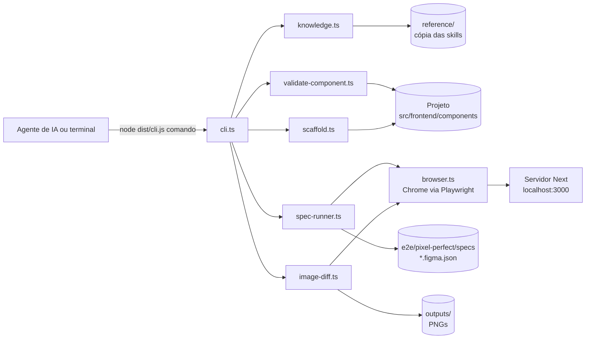

# Como o CLI da skill ue-pattern funciona

## Visão geral



O CLI é um processo de vida curta: recebe o comando e as opções (`node:util parseArgs`), executa e escreve o resultado em `stdout`. Em caso de erro escreve `Erro: <mensagem>` em `stderr` e sai com código 1. Não abre porta de rede. O agente de IA chama o CLI pelo terminal, guiado pelo `AGENTS.md` (ou pelo `SKILL.md`, no Claude Code).

## 1. Consulta ao padrão

A base é a pasta `reference/`, copiada das skills `padrao-universo-editor-adobe` (vira `reference/construcao/`) e `padrao-autoria-ue` (vira `reference/autoria/`) (26 arquivos `.md`).

- **`topicos`**: varre os `.md`. O **id** de um tópico é o caminho relativo sem `.md`, por exemplo `autoria/RESUMO` ou `construcao/reference/architecture/overview`.
- **`ler`**: lê o arquivo. Com `secao`, devolve só o trecho do primeiro heading cujo título **contém** o texto (sem diferenciar maiúsculas), indo até o próximo heading de nível igual ou superior. Subseções vêm junto.
- **`buscar`**: quebra a consulta em palavras com mais de 2 letras e pontua cada arquivo linha a linha. Uma linha com `n` palavras acertadas soma `n²`, então linhas que juntam vários termos pesam mais. Devolve até 3 trechos por arquivo.

**Segurança:** o id do tópico passa por `caminhoDentro()`, que resolve o caminho e recusa qualquer coisa fora de `reference/`. Um id como `../../etc/passwd` retorna erro.

**Limite:** a busca é lexical. Ela acha as palavras que você escreveu, não sinônimos.

## 2. Validação de componente

`validar` recebe um caminho `.../<grupo>/[sections|components]/<nome>/v1` (relativo a `src/frontend/components` ou absoluto) e lê os arquivos. **É análise estática por texto e regex**, não compila TypeScript nem executa o componente.

### Como grupo e nome são descobertos

O grupo é a **primeira pasta abaixo de `src/frontend/components`**. Isso cobre componentes aninhados como `grupo/.../cadastro/LeadForm/v1`, onde o grupo é `grupo` e não `cadastro`. O nome é a pasta imediatamente antes de `v1`.

### Como `name`, `group`, `version` e `modelId` são lidos

Do mesmo jeito que o gerador de registry do projeto (`scripts/generate-component-registries.ts`): recorta o arquivo a partir de `: ComponentDefinition = {`, tenta um literal de string e, se achar um identificador (`modelId: MODEL_ID`), resolve a constante. Assim o CLI vê o que o registry vê. A primeira versão do validador não fazia isso e dava falso positivo em definitions com constantes auxiliares antes do objeto principal.

### Regras e severidades

**Erro** significa que quebra o registry, o runtime ou uma regra dura do padrão. **Aviso** é convenção. **Info** é só para você saber.

| Regra | Sev. | O que checa | Por quê |
|---|---|---|---|
| `estrutura/arquivo` | erro | `definition.ts` e `mapper.ts` existem | Sem eles o registry não monta o componente |
| `estrutura/componente` | erro | existe `<nome>.tsx` | O gerador importa `<pasta>/<nome>`; outro nome quebra o import |
| `estrutura/index` | aviso | `index.ts` existe | Barrel é convenção |
| `estrutura/teste` | aviso | `__tests__/mapper.test.ts` com `describe(` | Convenção |
| `definition/group` | erro | `group` presente e igual à pasta do grupo | O picker e a renderização filtram por grupo |
| `definition/modelId` | erro | começa com `<grupo>--` | Padrão de nomes do modelo do UE |
| `definition/modelId` | aviso | igual a `<grupo>--<nome-em-kebab>` | PascalCase vira kebab (`HeaderPF` → `header-pf`) |
| `definition/name`, `definition/version` | erro | presentes | O registry **ignora** definitions sem eles |
| `definition/dl-fields` | aviso | usa `...DL_FIELDS` ou `build*DataLayerFields` | Tagueamento. Convenção que nem todo componente existente segue |
| `definition/abas` | aviso | usa `tab()` | Dialog organizado em abas |
| `definition/load` | info | `export const load` | O registry gerado não depende dele |
| `definition/multifield` | info | multifield sem `subItems` | Só é correto com item de um valor escalar |
| `mapper/puro` | erro | sem `fetch(`, `await`, `async` | Mapper é síncrono e puro |
| `mapper/nullish` | erro | sem `?? undefined` | String vazia do AEM passa reto pelo `??`; use `\|\| undefined` |
| `mapper/tipo`, `mapper/satisfies` | aviso | `MapperFn` e `satisfies <Nome>Props` | Tipagem |
| `mapper/export` | erro | `export default` | O registry carrega o mapper pelo default |
| `index/*` | aviso | exporta default, `definition` e `mapper` | Barrel |
| `tsx/aue-manual` | erro | sem `data-aue-*` escrito à mão | Use `getEditorProps()` |
| `tsx/editor-props` | aviso | usa `getEditorProps` ou `rootEditorProps` | Edição in-context |
| `tsx/use-client` | erro | hook ou handler exige `"use client"` | Falha de build |
| `tsx/use-client` | aviso | `"use client"` sem estado/efeito/evento | Deveria ser Server Component |
| `tsx/texto-hardcoded` | aviso | texto solto entre tags JSX | Texto autorável vem de `richTextHtml()`. **Heurística** |
| `tsx/css-module` | aviso | tem CSS Module próprio ou importado | Aceitável se delegar a um organismo |
| `css/cursor-pointer` | aviso | `<button>` custom com `cursor: pointer` | O browser não herda isso como em `<a href>` |
| `css/tokens` | info | conta cores hex literais | Confira se existe token `--brad-*` no Design System |

Comentários de código são removidos antes das checagens do `.tsx` e do `mapper.ts`, preservando a numeração de linhas. Sem isso, um comentário citando `data-aue-*` gerava erro falso.

### Calibração contra o código real

Rodei o validador em 52 componentes reais de 3 grupos. Com a raiz de componentes informada (como o servidor faz), **nenhum erro** restou. Os avisos mais comuns são `dl-fields` (25), `abas` (21) e `satisfies` (15): são desvios de convenção reais do código existente, não bugs do validador.

Calibrar com código real importa porque foi assim que apareceram três falsos positivos que um teste sintético não pegaria: pasta PascalCase vs modelId kebab, constantes antes do `ComponentDefinition`, e `data-aue-` dentro de comentário.

### `validar-grupo`

Encontra todo diretório `vN` que contém `definition.ts` sob o grupo, valida cada um e ordena pelos que têm mais erros. Detalha só os que falharam.

## 3. Scaffold (`criar --gravar`)

Gera 6 arquivos seguindo a anatomia do padrão:

```
<grupo>/<sections|components>/<nome>/v1/
  definition.ts   mapper.ts   <nome>.tsx   <Nome>.module.css   index.ts
  __tests__/mapper.test.ts
```

- **Dry-run por padrão.** `gravar=true` é explícito. O dry-run devolve o conteúdo de cada arquivo.
- **Nunca sobrescreve.** Se qualquer um dos 6 arquivos já existe, nada é gravado e a ferramenta falha.
- **Campos:** por padrão `title` e `description` (richtext). Tipos aceitos: `text`, `richtext`, `asset`, `boolean`. `asset` gera o filtro de DAM e o `resolveAsset`; `richtext` usa `richTextHtml()` e `dangerouslySetInnerHTML`.
- **`richTextHtml`:** o import usa `<grupo>/_shared/richtext` se existir, senão `global/_shared/richtext`.
- **Sem comentários** nos arquivos gerados, por regra sua, e há teste garantindo isso.
- **Auto-validação:** ao gravar, a ferramenta roda `validarComponente` no resultado. Um teste garante que tudo que o scaffold gera passa sem erros.
- **Depois de gravar:** rode `npm run generate:registries` no projeto. O CLI não faz isso por você.

## 4. Validação visual com spec do Figma (`spec`)

É o validador Playwright que já existia em `e2e/pixel-perfect.spec.ts`, portado para dentro do CLI. A lógica de comparação (`spec.ts`) é cópia de `scripts/pixel-perfect/spec.ts`; o runner (`spec-runner.ts`) reproduz o e2e sem depender do `@playwright/test`.

Fluxo, para cada frame do spec (por exemplo `desktop` 1440 e `mobile` 360):

1. Define o viewport com a largura do frame e abre `baseUrl + spec.url`.
2. Espera o seletor `waitFor` (até 15 s) e `document.fonts.ready`.
3. Para cada elemento do spec, lê `getComputedStyle` e compara com o valor esperado.
4. Verifica a **ordem visual** e o **alinhamento** entre irmãos, se declarados.

**Tolerância zero**: o único desconto é um epsilon de `1e-6` px, só para ruído de ponto flutuante (1.2 × 24 dá 28.799999999999997, não 28.8). Uma divergência real de 0.001 px reprova.

Unidades suportadas: `px`, `ratio` (line-height como múltiplo do font-size), `em` e `color` (normaliza `rgb()`/`rgba()` para hex).

Por que ordem e alinhamento existem: comparar propriedade a propriedade **não enxerga sequência nem degrau**. Um carrossel acima do título passa com 0 divergências; cards com descrições de alturas diferentes passam e ficam desalinhados. Ambos foram aprendidos na prática (2026-09-26).

**Se o seletor `waitFor` não aparece**, o erro mostra a URL final e o status HTTP. Foi o que apareceu no teste com `portfolio.figma.json`: a rota respondia 404 no ambiente local, então o problema era de conteúdo e não do validador.

Os specs são extraídos do Figma pelo plugin Desktop Bridge (fora desta skill) e gravados em `e2e/pixel-perfect/specs/<nome>.figma.json`. O formato está em `e2e/pixel-perfect/specs/EXEMPLO.figma.json.template` no projeto.

## 5. De-para por imagem (`comparar`)

Compara **pixels**, não medidas. Serve para o que o spec não cobre: gradientes, sombras, imagens, texto quebrando diferente.

Fluxo:

1. Lê a imagem de referência (PNG obrigatório; a assinatura do arquivo é conferida).
2. Abre a página no Chrome com o viewport e a escala pedidos, desliga animações e transições, espera as fontes e captura a página inteira, a janela ou um seletor.
3. Se as dimensões diferem, o menor é completado com magenta translúcido até o tamanho do maior, então a diferença de tamanho **aparece no diff e reprova**.
4. `pixelmatch` compara com `tolerancia` (sensibilidade de cor, padrão 0.1; 0 é estrito) e ignora anti-aliasing.
5. Calcula o percentual e agrupa as diferenças em **faixas verticais de 100 px**, devolvendo as 8 maiores.
6. Grava em `outputs/`:
   - `<nome>.depara.png`: **referência | atual | diff** lado a lado;
   - `<nome>.diff.png`: só as diferenças, em vermelho;
   - `<nome>.atual.png`: a captura.

**Aprovado** exige percentual menor ou igual a `limitePercentual` (padrão 0) **e** dimensões idênticas.

### Como obter uma boa referência

- A referência precisa ter a **mesma largura do viewport**. Exportou o frame de 1440 px no Figma a 1x? Use `largura: 1440`. Exportou a 2x? Use `escala: 2`.
- Para comparar só um bloco, passe `seletor` e use como referência o export do nó correspondente.
- O Figma não renderiza fontes e imagens exatamente como o browser. Espere algum ruído em texto; por isso existem `tolerancia` e `limitePercentual`. Use `spec` para o que precisa ser exato e o de-para para o visual geral.
- Para comparar com o **legado**, tire a captura do `localhost:PORTA` (servidor do legado) e use como referência.

## Segurança e limites

- Leitura da base e dos specs só dentro das pastas permitidas (proteção contra path traversal).
- `criar --gravar` não sobrescreve e é dry-run por padrão.
- Nenhum comando faz commit, push ou alteração fora de `criar --gravar` (arquivos do componente) e `comparar` (PNGs em `outputs/`).
- O CLI não envia nada para serviços externos. O Chrome só acessa a `baseUrl` e as URLs que você passar.
- As validações são **estáticas ou por medição**. Elas não substituem `lint`, `typecheck` e o teste do dialog no Universal Editor.
- `tsx/texto-hardcoded` e `css/tokens` são heurísticas. Trate como pistas.
- Se o Chrome não for achado, defina `CHROME_EXECUTABLE_PATH`.

## Como estender

- **Nova regra de validação:** adicione em `validate-component.ts` com `add(regra, severidade, arquivo, mensagem, linha?)` e um teste em `tests/scaffold-validate.test.ts`. Calibre contra componentes reais antes de dar `erro`.
- **Novo comando:** novo `case` em `executar()` de `cli.ts`, com a opção declarada em `parseArgs`, e uma linha na tabela do `SKILL.md`.
- **Nova skill na base:** inclua o nome em `scripts/sync-knowledge.mjs` e rode `npm run sync-knowledge`.

## Solução de problemas

| Sintoma | Causa provável |
|---|---|
| `Projeto sem src/frontend/components` | Rode na raiz do projeto ou use `--projeto` |
| `Chrome/Chromium não encontrado` | Defina `CHROME_EXECUTABLE_PATH` |
| `Seletor waitFor não apareceu` | Servidor fora do ar, rota 404 ou componente não está na página; veja a URL e o HTTP no erro |
| `Arquivo não é PNG` | Reexporte a referência em PNG |
| Dimensões diferentes no de-para | Largura do viewport ou escala não bate com a da referência |
| Tópico não encontrado | Rode `topicos` para ver os ids; rode `sync-knowledge` se a skill é nova |
