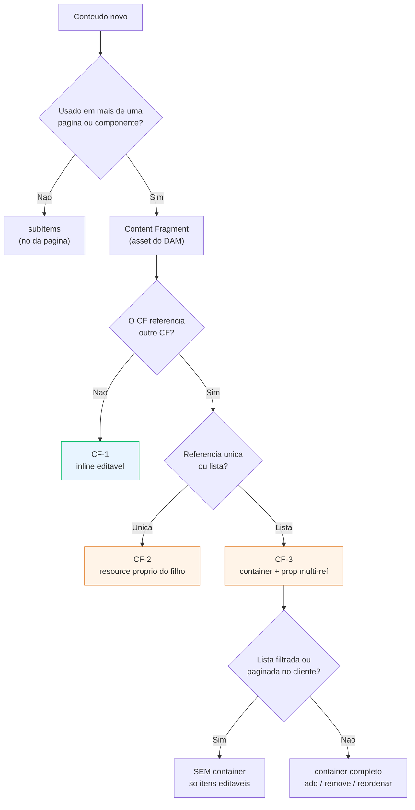

# Padrão de Content Fragments editáveis no Universal Editor

> Status: **v1 — em convergência**
> Última revisão: 2026-09-26
> Escopo: projeto Next.js + AEM (`seu-projeto`), pathway `aem` (páginas JCR + CFs no DAM)
> Documentos irmãos: [`padrao-listas-e-subitems.md`](./padrao-listas-e-subitems.md) · [`padrao-seo-texto.md`](./padrao-seo-texto.md)

## O que este documento resolve

O projeto tem 11 componentes alimentados por Content Fragment e 8 scripts de
provisionamento. O conteúdo chega por GraphQL e renderiza certo. **Mas o
gestor não consegue editar quase nada disso dentro do Universal Editor** — ele
precisa sair pro editor de CF, achar o fragmento, editar às cegas e voltar.

Pior no caso de **content reference**: quando um CF aponta pra outro CF, o
conteúdo aninhado não é editável em lugar nenhum do fluxo visual.

Este documento fixa como tornar CF — inclusive aninhado — editável in-context,
como se fosse componente.

---

## O mecanismo — três formas de URN

Tudo depende de pra onde o `data-aue-resource` aponta. A Adobe é explícita:

> _"data-aue-resource is always required since it is the primary key indicating
> where content changes are written."_
> — [Attributes and Types](https://experienceleague.adobe.com/en/docs/experience-manager-cloud-service/content/implementing/developing/universal-editor/attributes-types)

| Alvo                 | URN                                                                | Uso                            |
| -------------------- | ------------------------------------------------------------------ | ------------------------------ |
| Nó JCR da página     | `urn:aemconnection:/content/<site>/<pagina>/jcr:content/root/<no>` | Seção comum, sub-item          |
| **Content Fragment** | `urn:aemconnection:<damPath>/jcr:content/data/master`              | Bloco alimentado por CF        |
| Variação de CF       | idem + `data-aue-variation="<nome>"`                               | Variação editorial do mesmo CF |

O sufixo `/jcr:content/data/master` é o que diz ao editor "isto é um Content
Fragment, e é a variação master". Sem ele, o editor tenta escrever num nó de
página que não existe.

`getEditorProps` (`src/server/editor/props.ts`) já suporta os três — inclusive
`variation`, que hoje não é usado por nenhum componente.

### O que o gestor ganha

> _"The fields defined in the content model of the selected Content Fragment
> are displayed and editable in the properties panel."_
> _"Changes are automatically saved once focus leaves the edited field."_
> _"The Universal Editor validates Content Fragment fields based on their
> models allowing you to enforce data integrity rules such as regex patterns
> and uniqueness constraints."_
> — [Authoring Content with the Universal Editor](https://experienceleague.adobe.com/en/docs/experience-manager-cloud-service/content/sites/authoring/universal-editor/authoring)

Ou seja: a validação do CF Model (regex, obrigatoriedade, unicidade) passa a
valer **dentro** do editor visual. É validação que o dialog de componente
comum não tem.

---

## Padrão CF-1 — CF simples, editável inline

Já implementado e funcionando em `sections/bank-branches/v1`. É a referência.

### Dialog da seção — só o ponteiro

```ts
fields: [
  tab("tab-conteudo", "Conteúdo"),
  {
    name: "cfPath",
    label: "Content Fragment",
    type: "aem-content",
    description: "Seleciona qual fragmento alimenta esta seção.",
  },
  SECTION_ID_FIELD,
];
```

O dialog da seção **não repete os campos do CF**. Ele só escolhe _qual_ CF.
Os campos do CF são editados clicando no conteúdo na tela.

### Root do bloco — aponta pro CF, não pra página

```tsx
const damPath = cfPath.split(";")[0].trim();

<section
  {...getEditorProps({
    resource: `${damPath}/jcr:content/data/master`,
    type: "reference",
    label: "Conheça o Produto",
  })}
>
```

> O `.split(";")[0]` não é decoração: o picker `aem-content` devolve o caminho
> com sufixo (`/content/dam/...;path`). Sem a limpeza, a URN fica inválida.

### Campos — nomes do CF Model, não do dialog

```tsx
<h3
  {...getEditorProps({
    prop: "bBContainerTitle",
    type: "text",
    label: "Título",
  })}
>
  {bBContainerTitle}
</h3>
```

`prop` usa o nome do campo **no CF Model**. É outro contrato, não o do
`definition.ts`.

---

## Padrão CF-2 — content reference simples (CF → CF)

Um campo do CF pai aponta pra um único CF filho. O filho é **outro asset**, com
caminho próprio. Logo: instrumentação própria.

```tsx
// pai
<section
  {...getEditorProps({
    resource: `${paiPath}/jcr:content/data/master`,
    type: "reference",
    label: "Seção",
  })}
>
  {/* filho — CF diferente, resource diferente */}
  <div
    {...getEditorProps({
      resource: `${filho._path}/jcr:content/data/master`,
      type: "reference",
      label: "Configuração",
    })}
  >
    <span {...getEditorProps({ prop: "titulo", type: "text" })}>
      {filho.titulo}
    </span>
  </div>
</section>
```

**Pré-requisito de GraphQL:** a persisted query precisa retornar `_path` de
cada CF referenciado. Sem o `_path` do filho, não existe URN, e o bloco não
tem como ser editável.

```graphql
mapInfo {
  _path          # obrigatório para instrumentar
  agencias { _path  title  address }
}
```

O editor colabora com esse fluxo:

> _"If you select a field that is related to a Content Fragment, the Content
> Fragment loads in the components panel and the field is automatically
> scrolled to."_

---

## Padrão CF-3 — multi-reference (lista de CFs)

Campo do CF pai que referencia **vários** CFs. Aqui entra a regra específica
da Adobe para container de CF:

> _"data-aue-prop is required whenever you want to edit in context except for a
> container where it is optional (**if set the container is a content fragment
> and the prop points to a multi-reference field**)."_

```tsx
// container = o CAMPO multi-referência do CF pai
<ul
  {...getEditorProps({
    resource: `${paiPath}/jcr:content/data/master`,
    type: "container",
    prop: "agencias", // o campo multi-ref no CF Model
    filter: "cf-agencia", // que CFs podem ser adicionados
  })}
>
  {agencias.map((a) => (
    // cada item = CF próprio
    <li
      key={a._path}
      {...getEditorProps({
        resource: `${a._path}/jcr:content/data/master`,
        type: "reference",
        label: a.title,
      })}
    >
      <h4 {...getEditorProps({ prop: "title", type: "text" })}>{a.title}</h4>
    </li>
  ))}
</ul>
```

Com isso o gestor adiciona, remove, reordena e edita CFs referenciados sem
sair da página. É o equivalente do `subItems`, só que os itens são assets do
DAM em vez de nós da página.

### Quando NÃO fazer o pai ser `container`

Se a lista é **filtrada, ordenada ou paginada no cliente**, o container mente:
o "+" adiciona ao fim da coleção real, mas o gestor está vendo um recorte. Pior
com reordenação — a ordem visível não é a ordem persistida.

Regra:

| A lista renderiza…                          | Pai                                     | Itens               |
| ------------------------------------------- | --------------------------------------- | ------------------- |
| Inteira, na ordem do CF                     | `type: "container"` + `prop` + `filter` | `type: "reference"` |
| Filtrada / paginada / reordenada no cliente | **sem container**                       | `type: "reference"` |

No segundo caso o gestor ainda edita cada item na tela — só não adiciona nem
reordena por ali. É o caso de `bank-branches`, que filtra por cidade
(`BankBranchesClient.tsx`).

---

## Quando usar CF, e quando não usar

CF não é "multifield melhor". É outro eixo: **reuso e governança**.

| Situação                                                | Padrão                                                                          |
| ------------------------------------------------------- | ------------------------------------------------------------------------------- |
| Conteúdo só existe nesta seção, nesta página            | `subItems` — ver [`padrao-listas-e-subitems.md`](./padrao-listas-e-subitems.md) |
| Mesmo dado em **várias páginas ou componentes**         | **Content Fragment**                                                            |
| Dado com validação forte (regex, unicidade)             | **Content Fragment** — CF Model valida, dialog de componente não                |
| Dado que times diferentes editam com governança própria | **Content Fragment**                                                            |

**Não crie CF só pra "organizar".** Todo CF adiciona: um modelo pra manter, uma
persisted query, um script de provisionamento, um ponto de cache e um passo a
mais pro gestor entender de onde o conteúdo vem.

Exemplo legítimo no projeto: `map-info` é fonte única de agências, consumido
por `bank-branches` **e** por `contact-form-config`. Duplicar seria garantir
divergência.

---

## Os três contratos são separados

Regra da skill `aem-universal-editor` (`knowledge/02-headless-authoring.md`):

```
CF Model            -> schema e validação durável
CF                  -> instância de conteúdo autorado
GraphQL/persisted   -> contrato de entrega e cache
data-aue-*          -> mapeamento DOM → recurso
UE model/filter     -> painel de propriedades e restrições de inserção
```

> _"Do not make a delivery query, a Content Fragment Model, and a Universal
> Editor model share an identifier or structure merely for convenience. They
> have separate responsibilities and can evolve independently through an
> explicit mapping."_

Na prática: o `mapper.ts` é o lugar do mapeamento explícito. Não renomeie campo
de CF Model pra "bater" com o dialog — mapeie.

---

## Limite de aninhamento

> _"Heavy use of Content Fragment references can significantly impact system
> performance, UI responsiveness, and GraphQL query execution. Aim to keep
> nesting to no more than ten levels."_
> — [Learn about using references in Content Fragments](https://experienceleague.adobe.com/en/docs/experience-manager-65/content/headless/author/references)

Dez é o teto técnico da Adobe. **O teto prático deste projeto é 2.** Acima
disso o gestor perde o modelo mental de onde o conteúdo mora, e a persisted
query vira um problema de performance antes de virar um problema de autoria.

---

## Fluxograma

```
                  Conteúdo novo para um componente
                              │
              ┌───────────────┴───────────────┐
              │ Esse dado é usado em mais de  │
              │ uma página ou componente?     │
              └───────┬───────────────┬───────┘
                  NÃO │               │ SIM
                      ▼               ▼
            ┌──────────────┐   ┌──────────────────┐
            │ subItems     │   │ Content Fragment │
            │ (nó da       │   │ (asset do DAM)   │
            │  página)     │   └────────┬─────────┘
            └──────────────┘            │
                              ┌─────────┴──────────┐
                              │ O CF referencia    │
                              │ outro CF?          │
                              └────┬──────────┬────┘
                               NÃO │          │ SIM
                                   ▼          ▼
                            ┌──────────┐  ┌─────────────────┐
                            │  CF-1    │  │ É lista (multi) │
                            │ inline   │  │ ou único?       │
                            └──────────┘  └──┬───────────┬──┘
                                       único │           │ lista
                                             ▼           ▼
                                      ┌──────────┐  ┌──────────┐
                                      │   CF-2   │  │   CF-3   │
                                      └──────────┘  └──────────┘
```

### Versão renderizável



---

## Gap atual — evidência

`sections/bank-branches/v1` é o componente mais avançado do projeto em CF, e
mostra os dois lados:

| O que                                                   | Estado                   |
| ------------------------------------------------------- | ------------------------ |
| CF raiz editável inline (`type: "reference"`)           | ✅ feito                 |
| `_path` de cada agência aninhada trazido do GraphQL     | ✅ feito (`cf-fetch.ts`) |
| `_path` propagado até o componente (`BankBranch._path`) | ✅ feito (`mapper.ts`)   |
| **Agências instrumentadas como editáveis**              | ❌ **falta**             |

`BankBranchesClient.tsx` renderiza cada agência usando só `branch._key`. O
`branch._path` está disponível, carregado, e não é usado. **Faltam três linhas
de `getEditorProps` por item** — todo o resto do caminho já existe.

Como a lista é filtrada por cidade, aplica-se a exceção do CF-3: instrumentar
os itens, **não** transformar o `<ul>` em container.

Outros 10 componentes com `cfPath` não instrumentam o CF de forma alguma — o
gestor edita esses fragmentos só pelo editor de CF.

---

## Checklist para componente novo com CF

- [ ] O dado é realmente reusado? Se não, use `subItems`
- [ ] O dialog da seção tem só `cfPath`, não uma cópia dos campos do CF
- [ ] `cfPath` passa por `.split(";")[0].trim()` antes de virar URN
- [ ] Root do bloco usa `<damPath>/jcr:content/data/master` + `type: "reference"`
- [ ] `prop` usa os nomes do **CF Model**, não os do `definition.ts`
- [ ] A persisted query retorna `_path` de todo CF aninhado
- [ ] CF referenciado tem `resource` próprio, nunca herda o do pai
- [ ] Lista multi-ref: container só se renderizar inteira e em ordem
- [ ] Aninhamento ≤ 2 níveis
- [ ] Campos de título/parágrafo seguem [`padrao-seo-texto.md`](./padrao-seo-texto.md)
- [ ] Script `scripts/generate-<nome>-cf.ts` criado para provisionar o modelo

---

## EM ABERTO — a validar

1. **`data-aue-variation`** — `getEditorProps` suporta, nenhum componente usa.
   Variação de CF permitiria versão A/B ou regional do mesmo fragmento sem
   duplicar. Falta confirmar como o editor expõe a troca de variação ao gestor.
2. **Filtro de CF no container (CF-3)** — a Adobe documenta `filter` no
   container, mas o `buildUEFilterForGroups` do projeto só gera filtros de
   componente de página. Definir como nomear e emitir filtros de CF.
3. **Validação do CF Model no UE** — a doc afirma que regex e unicidade são
   aplicados no editor. Confirmar no AEM local se os CF Models provisionados
   pelos `scripts/generate-*-cf.ts` carregam essas regras.

---

## Fontes consultadas

**Documentação oficial Adobe**

- [Attributes and Item Types](https://experienceleague.adobe.com/en/docs/experience-manager-cloud-service/content/implementing/developing/universal-editor/attributes-types) — `data-aue-resource` como chave primária, `data-aue-prop` opcional em container de CF apontando pra campo multi-referência, tipo `reference`
- [Authoring Content with the Universal Editor](https://experienceleague.adobe.com/en/docs/experience-manager-cloud-service/content/sites/authoring/universal-editor/authoring) — painel de propriedades com campos do CF Model, auto-save, validação por modelo, navegação automática para o CF referenciado, "Open in CF Editor"
- [Universal Editor Overview for AEM Developers](https://experienceleague.adobe.com/en/docs/experience-manager-cloud-service/content/implementing/developing/universal-editor/developer-overview) — formato `urn:<referenceName>:<resource>` e meta tag de conexão
- [Model Definitions, Fields, and Component Types](https://experienceleague.adobe.com/en/docs/experience-manager-cloud-service/content/implementing/developing/universal-editor/field-types) — `aem-content-fragment`, `aem-content`, `reference`
- [Learn about using references in Content Fragments](https://experienceleague.adobe.com/en/docs/experience-manager-65/content/headless/author/references) — limite de ~10 níveis, impacto em performance e GraphQL
- [Content Fragment Models](https://experienceleague.adobe.com/en/docs/experience-manager-cloud-service/content/assets/content-fragments/content-fragments-models) — tipos de dados de referência

**Repositórios Adobe**

- [`adobe/skills`](https://github.com/adobe/skills) — verificado: **não há** skill dedicada a Content Fragments no Universal Editor. A skill `ue-component-model` cobre `aem-content-fragment` apenas como tipo de campo.

**Skill instalada localmente**

- documentação Adobe do Universal Editor — `knowledge/02-headless-authoring.md` (separação dos contratos, boundary map, modos de falha), `knowledge/01-architecture.md`

**Ressalva de frescor**

- Este projeto usa **exclusivamente** o Universal Editor sobre páginas AEM
  (pathway `aem`). Recomendações de Edge Delivery Services foram omitidas.
- A documentação de autoria consultada **não** cobre limites de referência
  aninhada nem variações de CF dentro do Universal Editor. Os itens 1 e 2 da
  seção EM ABERTO ficam sem fonte oficial até validação local — não presuma
  comportamento.
