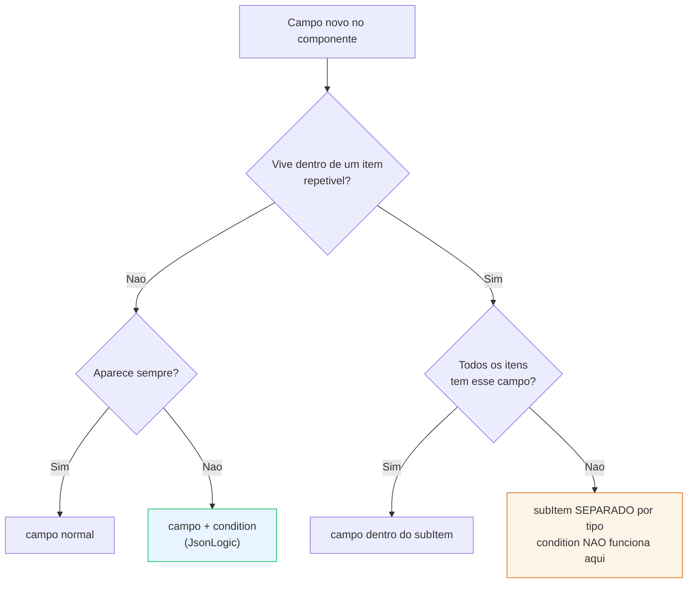

# Padrão de Listas Repetíveis e Sub-itens — AEM Universal Editor

> Status: **v1 — em convergência**
> Última revisão: 2026-09-26
> Escopo: projeto Next.js + AEM (`seu-projeto`), pathway `aem` (páginas JCR)
> Documento irmão: [`padrao-seo-texto.md`](./padrao-seo-texto.md)

## Por que este documento existe

Qualquer seção com itens repetidos — cards, slides, perguntas de FAQ, linhas de
tabela — cai numa escolha de arquitetura que decide se o gestor consegue ou não
trabalhar. Feita errado, o resultado é um dialog de 50 campos onde ele edita
às cegas.

Este documento fixa a escolha para **componentes novos**.

---

## A limitação que decide tudo

Adobe, [Customizing the Universal Editor](https://experienceleague.adobe.com/en/docs/experience-manager-cloud-service/content/implementing/developing/universal-editor/customizing), verbatim:

> _"Condition var resolution is absolute, not relative to the current row."_
> _"conditions inside multi containers aren't supported"_

Motivo: o conteúdo de uma linha é indexado em runtime como
`containerName/0|fieldName`. Esse índice não existe quando você escreve a
condição, e muda quando o autor reordena.

**Consequência prática:** dentro de um item repetível, `condition` não é uma
opção ruim — é não-suportado. Não dá pra esconder campo por variação lá dentro.

Some a isso, da mesma documentação:

> _"container nesting is not permitted for multi-fields in the properties panel"_
> — [Model Definitions, Fields, and Component Types](https://experienceleague.adobe.com/en/docs/experience-manager-cloud-service/content/implementing/developing/universal-editor/field-types)

Multifield dentro de multifield: proibido.

E, sem resolução até hoje: reordenar o **último** item de um multifield duplica
em vez de mover — [thread na Experience League](https://experienceleaguecommunities.adobe.com/adobe-experience-manager-edge-delivery-services-13/issue-with-multifield-container-reordering-in-aem-universal-editor-146855).

---

## Decisão 1 — `subItems` é o default. Multifield cru é a exceção.

> Esta decisão **substitui** a tabela "Três padrões de conteúdo repetido"
> (§3 de `construcao/RESUMO.md`), que hoje lista
> _"Multifield inline (default)"_. Aquele default é a origem dos dialogs
> gigantes do grupo `outro-grupo`.

| Item contém…                  | Padrão         |
| ----------------------------- | -------------- |
| 1 valor escalar (string, tag) | multifield cru |
| 2+ campos, ou imagem, ou link | **`subItems`** |

O critério antigo era _"sem reuso cross-page"_. Isso mistura duas perguntas
diferentes: **onde o dado mora** (multifield vs Content Fragment) e **como o
autor edita** (dialog do pai vs dialog do item). Quem sente a diferença é o
gestor, e o critério antigo responde a pergunta errada.

### O que `subItems` entrega

- `condition` volta a funcionar nos campos do item (mesmo model)
- sem o bug de reordenação
- o autor **clica no card na tela** e edita aquele card
- abas por item

---

## Decisão 2 — Variação que muda campos é outro `subItem`

**Se a variação muda os CAMPOS → `subItem` separado.
Se muda só a APARÊNCIA → `select` dentro do item.**

```ts
subItems: [
  {
    id: "global--card-produto",
    title: "Card Produto",
    containerField: "cards",
    fields: [
      tab("conteudo", "Conteúdo"),
      ...tituloFields,
      ...imagemFields,
      {
        name: "highlights",
        label: "Destaques",
        type: "multifield",
        fields: [{ name: "text", label: "Texto", type: "text" }],
      },
      tab("link", "Link"),
      ...linkFields,
    ],
  },
  {
    id: "global--card-icone",
    title: "Card Ícone",
    containerField: "cards",
    fields: [
      tab("conteudo", "Conteúdo"),
      ...tituloFields,
      { name: "icon", label: "Ícone (classe DS)", type: "text" },
      tab("link", "Link"),
      ...linkFields,
    ],
  },
];
```

O filtro do container decide quais tipos entram naquela seção. **O picker do
"+" vira a UI de variação** — o gestor escolhe o tipo antes de ver os campos,
em vez de mexer num dropdown e ver o formulário se transformar.

### Alternativas descartadas, e por quê

| Alternativa                                                            | Por que não                                                                                                                     |
| ---------------------------------------------------------------------- | ------------------------------------------------------------------------------------------------------------------------------- |
| `cardType` como campo **do item**                                      | Funciona tecnicamente, mas libera o gestor a misturar tipos no mesmo grid. Inconsistência visual por default — risco de produto |
| **União de todos os campos** num model só (padrão atual do `cards/v1`) | O gestor vê campos que não fazem nada e não tem como saber quais. Preenche, acha que quebrou, abre chamado                      |

Sobre o custo de N models: mitigado com arrays compartilhados — o projeto já
faz isso (`...imageFields`, `...linkFields` em `cards/v1/definition.ts`).
Duplicação real fica perto de zero.

---

## Decisão 3 — `components: null` só no root, só em dev

Adobe, [Filters](https://experienceleague.adobe.com/en/docs/experience-manager-cloud-service/content/implementing/developing/universal-editor/filtering):

> _"Setting the `components` attribute in a filter definition to `null` allows all components, as if there were no filter."_

```json
{ "id": "page-sections", "components": null }
```

**Nunca use `null` em filtro de container de item.** Isso deixa o autor
arrastar uma seção inteira pra dentro de um card. Não gera erro — gera conteúdo
inválido que só aparece em produção.

Hoje `buildUEFilterForGroups([])` lista os 112 componentes explicitamente. Efeito
igual ao `null`, payload maior. Vale trocar pelo `null` **só** no root, e fazer
o fallback de `componentGroups` vazio falhar visivelmente em dev.

---

## Fluxograma de decisão

```
                    Campo novo no componente
                              │
                ┌─────────────┴─────────────┐
                │ Ele vive dentro de um     │
                │ item repetível (card,     │
                │ slide, linha, pergunta)?  │
                └─────────────┬─────────────┘
                     NÃO ──┐  │  ┌── SIM
                           ▼  │  ▼
        ┌──────────────────┐  │  ┌────────────────────────┐
        │ CAMPO RAIZ       │  │  │ CAMPO DE ITEM          │
        │ da seção         │  │  │                        │
        └────────┬─────────┘  │  └───────────┬────────────┘
                 │            │              │
   ┌─────────────┴──────┐     │   ┌──────────┴───────────┐
   │ Aparece sempre?    │     │   │ Todos os itens têm   │
   └──────┬──────┬──────┘     │   │ esse campo?          │
      SIM │      │ NÃO        │   └──────┬────────┬──────┘
          ▼      ▼            │      SIM │        │ NÃO
     ┌────────┐ ┌──────────┐  │          ▼        ▼
     │ campo  │ │ campo +  │  │   ┌──────────┐ ┌──────────────┐
     │ normal │ │ condition│  │   │ campo no │ │ subItem      │
     └────────┘ └──────────┘  │   │ subItem  │ │ SEPARADO     │
                              │   └──────────┘ │ por tipo     │
                              │                │              │
                              │                │ condition    │
                              │                │ NÃO funciona │
                              │                │ aqui         │
                              │                └──────────────┘
```

Regra em uma linha: **`condition` na raiz, `subItem` no item.**

### Versão renderizável



---

## As 3 peças — falta uma, desmonta

`subItems` na definition **não é** o que o autor preenche. É o registro. Precisa
das três juntas. Referência completa e funcionando: `src/frontend/components/sections/cards/v1/`.

### Peça 1 — declara o item (`definition.ts`)

```ts
subItems: [
  {
    id: "global--cards-card",
    title: "Card",
    containerField: "cards", // nome do campo no pai
    fields: allCardFields,
  }, // ISTO vira o dialog do card
];
```

Gera automaticamente, em `src/server/editor/providers/aem/definitions.ts`:

| O quê     | Onde                                 | Pra quê                         |
| --------- | ------------------------------------ | ------------------------------- |
| Definição | `buildUESubItemComponentDefinitions` | "Card" aparece no picker do "+" |
| Model     | `buildUEModelDefinitions`            | O dialog do card, com as abas   |
| Filtro    | `buildUEFilterForGroups`             | Só "Card" entra no container    |

### Peça 2 — o pai marca o container (`<nome>.tsx`)

```tsx
const containerProps = getEditorProps({
  resource: `${_path}/cards`,
  type: "container",
  filter: cardModel,
  label: "Cards",
});
```

Sem isso o UE não desenha o botão "+".

### Peça 3 — o filho marca a si mesmo (atom)

```tsx
const rootProps = getEditorProps({
  resource: _path, // .../cards/item0
  type: "component",
  model, // "global--cards-card"
});
```

Sem isso, clicar no card não abre nada — ou abre o dialog do pai.

### E o `_path` precisa bater com o JCR

```ts
// mapper.ts
const nodeName = (obj._jcrKey as string) || `item${index}`;
_path: (obj._path as string) || `${parentPath}/cards/${nodeName}`,
```

O UE não "sabe" que o card é editável porque foi declarado. Ele lê o
`data-aue-resource` do DOM e vai buscar aquele nó no AEM. Caminho errado →
_"Falha ao buscar detalhes"_ ao clicar.

---

## Como fica pro gestor

```
  ┌──────────┐  ┌──────────┐  ┌──────────┐
  │  Card 1  │  │  Card 2  │  │    +     │  ← clica aqui
  └──────────┘  └────┬─────┘  └────┬─────┘
                     │             │
       clica ────────┘             └──────► ┌─ Adicionar ─────────┐
                     │                      │ ▸ Card Produto      │
                     ▼                      │ ▸ Card Ícone        │
   ┌─ Card Produto (item 2) ─────────┐      └─────────────────────┘
   │ [Conteúdo] [Link]               │         ↑ o filtro do container
   │                                 │           decide o que entra
   │ Título    [_______________]     │
   │ Nível     [H3 — subtítulo  ▾]   │
   │ Imagem    [ Selecionar…    ]    │
   │ Destaques  + adicionar          │
   └─────────────────────────────────┘
```

Comparado com multifield cru:

|                  | Multifield cru                              | Container + item              |
| ---------------- | ------------------------------------------- | ----------------------------- |
| Editar o 3º card | Abre dialog do pai, rola, expande a linha 3 | **Clica no 3º card na tela**  |
| Abas             | Uma pro componente inteiro                  | **Por card**                  |
| Adicionar        | "+" dentro do dialog                        | **"+" no canvas, com picker** |
| Reordenar        | Arrastar linha (bug no último)              | Arrastar o card               |
| Ver o que edita  | Não vê                                      | **Vê o card destacado**       |

---

## Threshold do carrossel: conte a largura, não os cards

Regra descoberta na primeira execução real: o número que ativa o carrossel sai
da **aritmética do container**, não de um palpite.

Seção de 1136px, cards de 272px, gap de 16px:

```
4 cards = 4×272 + 3×16 = 1088 + 48 = 1136  → cabe exato, nada a rolar
5 cards = 5×272 + 4×16 = 1360 + 64 = 1424  → transborda, carrossel faz sentido
```

Com threshold 4, o carrossel ativava mas as duas setas nasciam desabilitadas —
controle morto na tela.

**Duas regras:**

1. O threshold é `floor(largura_do_container / (card + gap)) + 1`. Aqui: 5.
2. **Só renderize o controle quando houver o que rolar.** Além do threshold,
   verifique `canScrollPrev || canScrollNext` — o container pode caber mais do
   que a conta previa em telas largas.

```tsx
{
  isCarousel && !isMobile && (canScrollPrev || canScrollNext) ? (
    <Setas />
  ) : null;
}
```

---

## Espaçamento entre seções: respiro mínimo, não o gap do Figma

No Figma o espaço vertical pertence ao **container da página**:

| Frame                | Container | `gap` entre seções |
| -------------------- | --------- | ------------------ |
| Desktop (`Conteúdo`) | 1440      | 152px              |
| Mobile (`Content`)   | 360       | 88px               |

O `PageShell` deste projeto **não distribui gap** — as seções empilham coladas.
Componente que não carrega o próprio respiro gruda na seção de cima assim que o
autor o reposiciona.

**A tentação é replicar 152/88 na seção. Não faça.** Esse valor pertence ao
container: aplicado em cada seção, abre um buraco entre blocos que o design
nunca previu, e piora quando a página mistura componentes que seguem a regra
com os que não seguem.

**Regra: respiro mínimo, em token do DS.**

```css
.root {
  margin-block-start: var(--ds-margin-sm);
} /* 16px */
@media (min-width: 768px) {
  .root {
    margin-block-start: var(--ds-margin-md);
  } /* 24px */
}
```

**`margin`, não `padding`.** Margens de irmãos **colapsam**: duas seções
seguidas ficam com 24px entre elas, não 48px. Com `padding` o valor soma.

O espaçamento editorial de verdade — os 152/88 — é responsabilidade do
container da página. Enquanto o `PageShell` não o distribuir, cada seção
garante só que não cola.

### Medir contra a seção certa

Ao verificar a folga, não use `previousElementSibling`: o irmão no DOM pode ser
um elemento `fixed` (aqui, o `floating-cta`), e a medida sai sem sentido —
chegou a acusar 6931px. Procure a seção cuja base é a maior entre as que ficam
acima do alvo, ignorando `position: fixed` e `absolute`.

---

## Âncora de seção (`sectionId`)

Componente de seção expõe `SECTION_ID_FIELD` (`_shared/dialog-fields.ts`), o
mesmo contrato do resto do portal — o nome do campo precisa ser `sectionId`
para que links `#id` autorados em **outros** componentes encontrem a âncora.

```tsx
<section id={sectionId} …>
```

E o `scroll-margin-top` compensa o header fixo. **No CSS Module, não inline**,
porque o valor muda por breakpoint:

```css
.root {
  scroll-margin-top: 54px;
}
@media (min-width: 768px) {
  .root {
    scroll-margin-top: 120px;
  }
}
```

Verificado: `#portfolio` rola até a seção e para com o topo a 120px da
viewport, sem o header cobrir o título.

---

## Checklist para componente novo com lista

- [ ] O item tem 2+ campos? Então usa `subItems`, não multifield cru
- [ ] As 3 peças estão no lugar (definition / container / atom)
- [ ] O `_path` do item bate com o nó JCR real
- [ ] Tipos com campos diferentes são `subItems` diferentes
- [ ] Nenhum `condition` dentro de campo de item (não é suportado)
- [ ] Nenhum multifield dentro de multifield
- [ ] O filtro do container lista tipos explícitos, nunca `null`
- [ ] Campos de título seguem [`padrao-seo-texto.md`](./padrao-seo-texto.md)
- [ ] Campos `richtext` do item têm perfil RTE no filtro do sub-item

---

## EM ABERTO — a validar antes de virar regra

### 1. `condition` num campo `tab`

Esconder uma **aba inteira** por variação resolveria casos da raiz com menos
ruído. O reference da Adobe descreve `tab` como _"purely UI organization. Not a
data field."_ e **não diz** se `condition` é respeitado nele.

Pode funcionar por acidente de implementação, pode ser ignorado.
**Não construir padrão em cima disso.** Teste: um componente local com
`tab` + `condition`, 10 minutos no AEM local. Resultado vira fato aqui.

### 2. Forma de persistência do multifield

Há contradição dentro do próprio código:

| Local                                       | Afirma                                                                                 |
| ------------------------------------------- | -------------------------------------------------------------------------------------- |
| `definitions.ts` (comentário do template)   | _"O UE serializa os itens como propriedade JSON do nó da seção — não usa sub-nós JCR"_ |
| `mapper.ts` (`normalizeCards`)              | Monta `_path` como sub-nó: `.../cards/item0`                                           |
| `_shared/multifield.ts` (`parseMultifield`) | Aceita **as duas formas**                                                              |

O parser foi escrito defensivamente porque as duas aparecem na prática.
**Abrir um `cards/v1` já autorado no CRXDE e olhar o nó.** Se já são sub-nós
`item0`/`item1`, migrar componentes existentes é só código — nenhum conteúdo
se move. Se for propriedade JSON, precisa de script.

Isso vale 10 minutos e muda o tamanho de qualquer projeto de migração.

---

## Dívida mapeada (fora do escopo do padrão, registrado)

15 componentes ainda usam multifield cru sem `subItems`. Quase todos no grupo
`outro-grupo`:

```
25 campos | Banner — Carrossel / Imagem      html/common/sections/Banner/v1
14 campos | Cartões (carrossel)              outro-grupo/sections/meu-cards/v1
14 campos | Cards de serviço em destaque     outro-grupo/sections/service-cards-featured/v1
11 campos | Header — Exemplo               outro-grupo/sections/meu-header/v1
 9 campos | FAQ                              global/sections/FAQ/v1
 9 campos | Carrossel de cards com CTA       outro-grupo/sections/cta-card-carousel/v1
 9 campos | Cards com imagem                 outro-grupo/sections/cards-with-image/v1
 8 campos | Formas de pagamento              outro-grupo/sections/payment-methods/v1
 7 campos | Apps parceiros                   outro-grupo/sections/partner-apps/v1
 6 campos | Perguntas frequentes             outro-grupo/sections/faq/v1
 6 campos | Cards de serviço                 outro-grupo/sections/service-cards/v1
 6 campos | Breadcrumb                       sections/breadcrumb/v1
 4 campos | Lista de arquivos PDF            outro-grupo/sections/pdf-files-list/v1
 3 campos | Carrossel de imagens             outro-grupo/sections/images-carousel/v1
 3 campos | Breadcrumb                       outro-grupo/sections/breadcrumb/v1
```

Outros 53 já usam `subItems`. O padrão não é novo — o grupo `outro-grupo` foi
construído antes dele.

`partner-apps/v1/definition.ts` carrega o sintoma documentado:
_"O UE não lida bem com multifield ANINHADO, então o modelo é ACHATADO"_ — cada
linha repete a categoria, e o componente reagrupa. Achatar transfere a
complexidade pro gestor, que digita a mesma categoria N vezes sem errar. Com
`subItems` por categoria, o problema não existe.

---

## Fontes consultadas

**Documentação oficial Adobe**

- [Customizing the Universal Editor](https://experienceleague.adobe.com/en/docs/experience-manager-cloud-service/content/implementing/developing/universal-editor/customizing) — `condition`/JsonLogic, resolução absoluta de `var`, não-suporte em multi containers
- [Model Definitions, Fields, and Component Types](https://experienceleague.adobe.com/en/docs/experience-manager-cloud-service/content/implementing/developing/universal-editor/field-types) — `container`, `multi`, proibição de nesting, lista dos 17 tipos
- [Filters](https://experienceleague.adobe.com/en/docs/experience-manager-cloud-service/content/implementing/developing/universal-editor/filtering) — `components: null`, `data-aue-filter`
- [Component Definition](https://experienceleague.adobe.com/en/docs/experience-manager-cloud-service/content/implementing/developing/universal-editor/component-definition) — grupos, IDs, `template`
- [Attributes and Types](https://experienceleague.adobe.com/en/docs/experience-manager-cloud-service/content/implementing/developing/universal-editor/attributes-types) — `data-aue-*`

**Repositórios Adobe**

- [`adobe/skills` — `ue-component-model`](https://github.com/adobe/skills) — padrão container/item (container leva `filter`, item leva `model`), exemplo Cards completo, `references/field-types.md`, `references/architecture.md`

**Comunidade Adobe**

- [Issue with Multifield Container Reordering](https://experienceleaguecommunities.adobe.com/adobe-experience-manager-edge-delivery-services-13/issue-with-multifield-container-reordering-in-aem-universal-editor-146855) — bug de reordenação, sem resolução

**Referência externa**

- [JsonLogic](https://jsonlogic.com/) — formato usado pelo `condition`

**Skill instalada localmente**

- documentação Adobe do Universal Editor — `knowledge/04-component-models.md`, `knowledge/05-definitions-and-filters.md`, `knowledge/extensibility/*`, `checklists/component-review.md`

**Ressalva de frescor**

- Este projeto usa **exclusivamente** o Universal Editor sobre páginas AEM
  (pathway `aem`, nós JCR). Recomendações específicas de Edge Delivery
  Services foram deliberadamente omitidas. Onde uma fonte Adobe documenta o
  padrão container/item com `resourceType` de Edge Delivery, só a **estrutura**
  foi aproveitada — os `resourceType` deste projeto são os nossos
  (`seu-projeto/components/...`), gerados em
  `src/server/editor/providers/aem/definitions.ts`.
