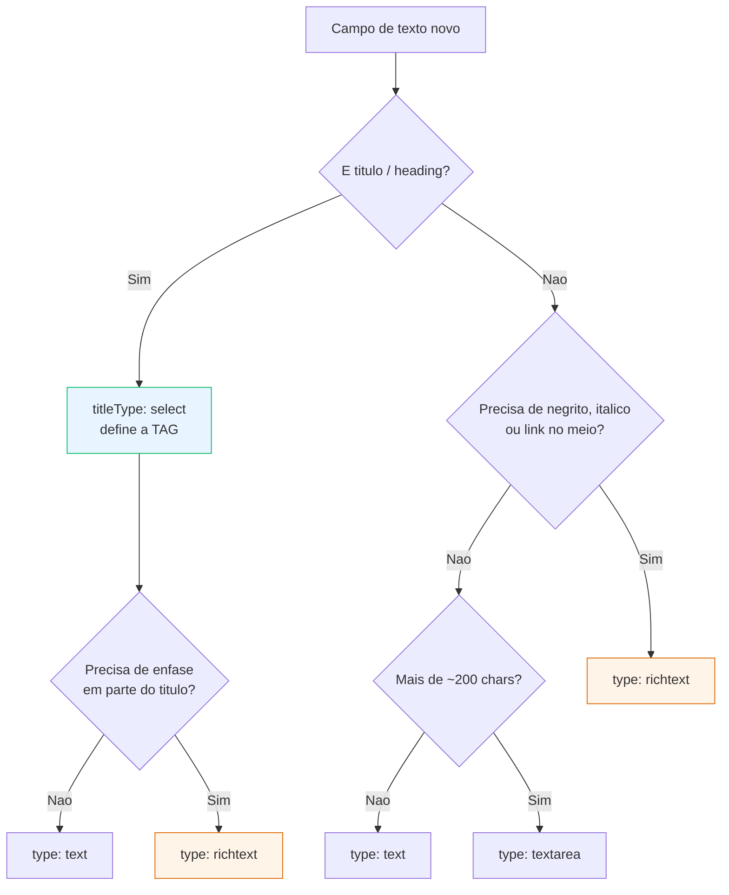

# Padrão de SEO e Campos de Texto — AEM Universal Editor

> Status: **v1 — em convergência**
> Escopo: projeto Next.js + AEM (`seu-projeto`), pathway `aem` (páginas JCR)

## Por que este documento existe

Dois problemas que se alimentam:

1. **SEO** — a hierarquia de headings (`h1` → `h2` → `h3`) precisa ser correta e
   consistente, mas o autor precisa de alguma liberdade pra adaptar a página.
2. **Identidade visual** — o CSS do Design System define cor, fonte, peso e
   espaçamento. Se o autor consegue sobrescrever isso pelo editor, o Design
   System vira sugestão.

Hoje os dois estão abertos. Este documento fecha os dois sem tirar a autonomia
do gestor.

## Diagnóstico — o vazamento atual

Nenhum filtro do projeto configura o RTE. O tipo `UEFilter`
(`src/server/editor/providers/aem/definitions.ts`) tem apenas:

```ts
interface UEFilter {
  id: string;
  components: string[];
}
```

Sem a propriedade `rte`, o Universal Editor entrega a toolbar padrão em
**todos** os campos `richtext` do projeto. Consequência mensurável, no próprio
código de renderização (`src/frontend/components/global/_shared/richtext.ts`):

| Função                            | O que ela faz                                   | O que isso revela                                  |
| --------------------------------- | ----------------------------------------------- | -------------------------------------------------- |
| `collapseDuplicateNestedSpans`    | Colapsa `<span>` aninhados com atributos iguais | O editor está gerando spans de estilo repetidos    |
| `hoistHeadingColorFromSingleSpan` | Move `color:` do span pro heading               | **Autores estão aplicando cor inline nos títulos** |

Essas funções não são bugs — são remendos corretos pra um problema que não
deveria existir. Com o RTE restrito, elas param de ter trabalho.

> **Nota de segurança (fora do escopo deste padrão, mas registrada):**
> `sanitizeRichText` é baseado em regex e alimenta `dangerouslySetInnerHTML`.
> Sanitização por regex é contornável. Avaliar biblioteca dedicada
> (`DOMPurify` no cliente / `isomorphic-dompurify` no server) em tarefa
> separada.

---

## Regra 1 — A tag vem do select. A ênfase vem de um richtext travado.

São duas perguntas diferentes, e misturá-las é a origem da bagunça:

| Pergunta                           | Quem responde                 |
| ---------------------------------- | ----------------------------- |
| **Qual tag** envolve o texto?      | `titleType` — campo `select`  |
| **Como enfatizar parte** do texto? | `richtext` com perfil travado |

O erro não é usar `richtext` num título. É deixar o `richtext` **decidir a
tag**. Se o perfil não expõe `blocks`, o autor não tem como emitir `<h1>` — e
a tag continua vindo do select, sempre.

### Definição

```ts
{ name: "title", label: "Título", type: "richtext" },
{
  name: "titleType",
  label: "Nível do título",
  type: "select",
  description: "Define a hierarquia da página para leitores de tela e buscadores.",
  options: [
    { label: "H2 — título de seção", value: "h2" },
    { label: "H3 — subtítulo", value: "h3" },
  ],
},
```

O campo `title` usa a toolbar padrão do RTE. Isso é seguro porque a **tag não
vem dele**: o `titleType` decide o wrapper, e o que o autor marcar dentro do
texto é formatação inline.

### Renderização

O projeto já tem o helper exato para isso —
`richTextInlineHtml` (`src/frontend/components/global/_shared/richtext.ts`),
que remove `<p>`, `<div>` e `<h1>`–`<h6>` e preserva as tags inline:

```tsx
const H = (titleType || "h2") as "h1" | "h2" | "h3";
return (
  <H
    {...getEditorProps({ prop: "title", type: "richtext" })}
    className={styles.title}
    dangerouslySetInnerHTML={richTextInlineHtml(title)}
  />
);
```

Resultado: `<h2 class="title">Invista com <em>liquidez diária</em></h2>`.

A tag é sua. A ênfase é dele. Nenhum dos dois invade o outro.

### Quando o título não precisa de ênfase

Componente onde o título nunca leva destaque interno: use `type: "text"` e
pule o richtext. Menos superfície, menos risco.

```ts
{ name: "title", label: "Título", type: "text" },
{ name: "titleType", label: "Nível do título", type: "select", options: [...] },
```

Os dois formatos são válidos. A escolha é por componente, e está no
fluxograma abaixo.

### Por que o label diz o papel, não a tag

`"H2 — título de seção"` em vez de `"H2"`. O gestor não precisa saber HTML pra
escolher certo. O papel é a informação que ele tem; a tag é consequência.

### Quantos níveis expor

**Exponha `h1` a `h6` em todo campo de título**, inclusive em item de lista.
O que muda por contexto é o **default**, não o que está disponível:

| Contexto                        | Opções          | Default |
| ------------------------------- | --------------- | ------- |
| Hero / primeira seção           | `h1`–`h6`       | `h1`    |
| Seção comum                     | `h1`–`h6`       | `h2`    |
| Item de lista (card, accordion) | `h1`–`h6`       | `h3`    |
| Eyebrow / kicker                | `p` + `h1`–`h6` | `p`     |

O **eyebrow também leva nível**. Costuma ser um `<p>` decorativo, mas em muitos
layouts é o rótulo semântico da seção — quem autora é que sabe.

O risco de dois `h1` na mesma página continua existindo. A resposta é
**auditoria**, não proibição: um teste que varre o HTML renderizado e falha com
mais de um `h1`. O autor não perde a ferramenta; o erro não passa.

Builder: `headingLevelField()` em `_shared/dialog-fields.ts`.

```ts
...headingLevelField("titleType", ["h1", "h2", "h3", "h4", "h5", "h6"], "h2")
...headingLevelField("eyebrowType", ["p", "h1", "h2", "h3"], "p", "Nível do eyebrow")
```

### O padrão vem primeiro na lista

O gerador do Universal Editor grava a **primeira opção** do `select` no
template do componente. Não há campo de default: quem define o valor inicial é
a ordem.

Listar `h1`–`h6` em ordem natural faria todo componente novo nascer com `h1` —
erro de SEO em qualquer seção que possa repetir na página.

Por isso `headingLevelField()` coloca o padrão em primeiro e o rotula:

```
H2 — título de seção (padrão)
H1 — título principal da página
H3 — subtítulo
H4 — subtítulo de item
```

```ts
headingLevelField("titleType", ["h1", "h2", "h3", "h4", "h5", "h6"], "h2");
```

O rótulo `(padrão)` explica por que aquele nível está fora da sequência. Os
demais seguem em ordem crescente.

Campos numéricos não precisam disso: o template nasce com `0`, e o mapper
converte no valor útil.

```ts
carouselThreshold: toPositiveInt(data.carouselThreshold, 5);
```

---

## Regra 2 — Parágrafo não tem `type`. Tem nível de liberdade.

**Parágrafo não precisa de um `paragraphType`.** `<p>` não tem variação
hierárquica — não existe "p2", e buscador não lê parágrafo como estrutura. Um
select ali seria ruído sem contrapartida.

A escolha real é outra: _quanta formatação o autor pode aplicar dentro do
parágrafo._ Três níveis, e só três:

| Nível                          | `type`     | Perfil RTE                             | Quando usar                         |
| ------------------------------ | ---------- | -------------------------------------- | ----------------------------------- |
| **Texto puro**                 | `text`     | —                                      | Rótulo, kicker, texto de botão, alt |
| **Texto longo sem formatação** | `textarea` | —                                      | Descrição corrida, texto de apoio   |
| **Parágrafo formatável**       | `richtext` | Parágrafo com negrito, itálico ou link |

### "E se eu quiser itálico em só uma parte da frase?"

Esse é exatamente o caso do terceiro nível, e é o uso **legítimo** do richtext.

A regra do padrão nunca foi "nunca use richtext". É:

> **Richtext para formatação inline dentro de texto em fluxo.
> Nunca para decidir estrutura.**

Itálico em meia frase é inline. É conteúdo, não estrutura. O CSS não se importa
com onde o `<em>` começa — ele define como `<em>` se parece, e só. Zero risco
de quebrar o Design System.

```ts
{ name: "description", label: "Descrição", type: "richtext" },
```

O gestor formata direto no texto:

```
Conheça o **CDB Exemplo**, com _liquidez diária_ e [rendimento acima do CDI](/cdb).
```

Sai como:

```html
<p class="description">
  Conheça o <strong>CDB Exemplo</strong>, com <em>liquidez diária</em> e
  <a href="/cdb">rendimento acima do CDI</a>.
</p>
```

Cor, fonte, peso e cor do link: todos do CSS Module. O autor não tem botão que
mude nenhum deles.

### O que continua proibido

| Proibido                                                        | Por quê                             |
| --------------------------------------------------------------- | ----------------------------------- |
| `blocks` com `h1`–`h6` no perfil                                | Título vem do `titleType` (Regra 1) |
| Qualquer controle de cor ou fonte                               | Aparência é do Design System        |
| `richtext` para valor que vira atributo (`alt`, `href`, classe) | Atributo não aceita HTML            |

---

## Regra 3 — Perfis de RTE: documentados, mas bloqueados neste projeto

A Adobe permite configurar a toolbar do RTE pela propriedade `rte` do **filtro**:

```json
{
  "id": "rte-corpo",
  "components": ["global--faq"],
  "rte": {
    "toolbar": {
      "format": ["bold", "italic"],
      "blocks": ["paragraph"],
      "list": ["bullet_list", "ordered_list"],
      "insert": ["link"]
    }
  }
}
```

Perfis que fazem sentido: `titulo` (só negrito/itálico), `inline` (+ link),
`corpo` (+ parágrafo e listas), `legal` (só negrito).

### Por que não estão implementados

**Duas razões, ambas verificadas:**

**1. Bloqueio de acesso.** Emitir o filtro exige alterar
`src/server/editor/providers/aem/definitions.ts` — acrescentar `rte?` ao tipo
`UEFilter` e empurrar os perfis em `buildUEFilterForGroups`. Este projeto **não
tem permissão de alterar `src/server`**.

**2. O perfil custa o seletor de cor.** Aplicar `data-aue-filter` num campo
`richtext` substitui a toolbar **inteira** pela declarada. Tudo que o perfil
não lista some — inclusive o controle de cor, que a instância AEM oferece por
padrão. Ver a Regra 3.1.

Ou seja: mesmo com acesso ao servidor, perfil em campo de título ou eyebrow
seria contraproducente. O caso legítimo é texto longo, termos e rodapé legal —
onde travar blocos e listas vale mais que a cor.

### O que fazer enquanto isso

Sem perfil, todo `richtext` recebe a toolbar padrão. O que protege o Design
System é a **Regra 1**: a tag do heading vem do `titleType`, nunca do RTE.
Mesmo com `blocks` disponível na toolbar, o wrapper é decidido pelo `select`.

---

## Regra 3.1 — Filtro de RTE tira o seletor de cor

A instância AEM deste projeto tem seletor de cor na toolbar do RTE. Mas ele
some quando o campo recebe um filtro:

> **Aplicar `data-aue-filter` num campo `richtext` substitui a toolbar inteira
> pela declarada no filtro.** Tudo que o perfil não lista desaparece —
> inclusive o seletor de cor.

Um campo sem filtro mostra a toolbar completa; com filtro, só o que o perfil
declarar.

### Quando aplicar perfil, e quando não

| Campo                                      | Perfil? | Porquê                              |
| ------------------------------------------ | ------- | ----------------------------------- |
| Corpo de texto longo, termos, rodapé legal | **Sim** | Vale travar blocos e listas         |
| Título, eyebrow, chamadas curtas           | **Não** | O autor precisa de cor por segmento |

O componente `global/portfolio` roda em qualquer segmento. A cor do eyebrow
muda entre temas, e travar isso no CSS obrigaria um componente por segmento.
Então: **sem filtro nesses campos, e sem `color` no CSS**.

```css
.eyebrow {
  /* Sem cor fixa: quem define é o texto rico. */
  color: inherit;
}
```

O conteúdo carrega a cor:

```html
<span style="color: #900f15;">Só o Premium para você</span>
```

### O custo, dito com honestidade

Cor no texto rico é **valor literal**, não token — não acompanha
`.brad-theme-*` automaticamente. Trocar o tema do segmento exige reautorar a
cor.

É o trade-off aceito aqui: controle direto do gestor vale mais que herança
automática de tema, num componente que muda de dono a cada campanha. Onde a
cor **deve** seguir o tema, mantenha o token no CSS e não exponha o campo.

## Regra 4 — Builders compartilhados, adesão opcional

Heading e parágrafo não devem ser reescritos em cada `definition.ts`. Viram
builders em `_shared/dialog-fields.ts`, no mesmo formato de `tab()` e
`buildDataLayerFields()` que o projeto já usa.

```ts
// src/frontend/components/_shared/dialog-fields.ts

type HeadingLevel = "h1" | "h2" | "h3" | "h4";

const LEVEL_LABEL: Record<HeadingLevel, string> = {
  h1: "H1 — título principal da página",
  h2: "H2 — título de seção",
  h3: "H3 — subtítulo",
  h4: "H4 — subtítulo de item",
};

export function headingFields(
  prefix = "title",
  levels: HeadingLevel[] = ["h2", "h3"],
  opts: { emphasis?: boolean; label?: string } = {},
): ComponentField[] {
  const { emphasis = false, label = "Título" } = opts;

  const fields: ComponentField[] = [
    { name: prefix, label, type: emphasis ? "richtext" : "text" },
  ];

  if (levels.length > 1) {
    fields.push({
      name: `${prefix}Type`,
      label: "Nível do título",
      type: "select",
      description:
        "Define a hierarquia da página para leitores de tela e buscadores.",
      options: levels.map((l) => ({ label: LEVEL_LABEL[l], value: l })),
    });
  }

  return fields;
}

export function paragraphField(
  name = "description",
  label = "Descrição",
  liberdade: "puro" | "longo" | "formatavel" = "formatavel",
): ComponentField {
  const type =
    liberdade === "puro"
      ? "text"
      : liberdade === "longo"
        ? "textarea"
        : "richtext";
  return { name, label, type };
}
```

### Uso

```ts
fields: [
  tab("tab-conteudo", "Conteúdo"),

  // título sem ênfase, só H2/H3
  ...headingFields(),

  // título com ênfase inline permitida
  ...headingFields("title", ["h2", "h3"], { emphasis: true }),

  // hero: H1 fixo, sem select
  ...headingFields("title", ["h1"]),

  // item de card: H3/H4
  ...headingFields("cardTitle", ["h3", "h4"], { label: "Título do card" }),

  paragraphField(),
  paragraphField("legal", "Texto legal", "puro"),
],
```

**Adesão é opcional.** Componente que não tem título não chama `headingFields`.
Componente com necessidade fora do padrão declara os campos na mão — mas aí a
exceção fica visível no diff, que é o objetivo.

`levels` com um único valor omite o select e fixa a tag. É assim que o hero
garante `h1` único sem depender do autor.

---

## Fluxograma — escolhendo o campo de texto

```
                     Campo de texto novo
                             │
              ┌──────────────┴──────────────┐
              │ É título / heading?         │
              └──────┬───────────────┬──────┘
                 SIM │               │ NÃO
                     ▼               ▼
   ┌──────────────────────────┐  ┌──────────────────────────┐
   │ titleType: select        │  │ Precisa de negrito,      │
   │ (a TAG vem daqui)        │  │ itálico ou link          │
   │         +                │  │ em parte do texto?       │
   │ Precisa de ênfase        │  └────┬──────────────┬──────┘
   │ em parte do título?      │   NÃO │              │ SIM
   └────┬────────────────┬────┘       ▼              ▼
    NÃO │                │ SIM  ┌────────────────┐  ┌──────────────────┐
        ▼                ▼      │ Mais de        │  │ type: "richtext" │
  ┌────────────┐  ┌───────────┐ │ ~200 chars?    │  └──────────────────┘
  │ type:      │  │ type:     │ └──┬──────────┬──┘
  │ "text"     │  │ "richtext"│NÃO │          │ SIM
  └────────────┘  └───────────┘    ▼          ▼
                                ┌────────┐ ┌──────────┐
                                │ "text" │ │"textarea"│
                                └────────┘ └──────────┘
```

---

### Versão renderizável



---

## Como fica pro gestor

**Título — liberdade controlada:**

```
┌─ Seção ─────────────────────────────────┐
│ Título        [Investimentos para você] │
│ Nível         [H2 — título de seção  ▾] │
│                  ├ H2 — título de seção │
│                  └ H3 — subtítulo       │
└─────────────────────────────────────────┘
```

Sem botão de cor. Sem escolha de fonte. Sem `h1` disponível numa seção que
repete.

**Parágrafo formatável:**

```
┌─ Descrição ─────────────────────────────┐
│ [ B ] [ I ] [ 🔗 ]                      │
│ ─────────────────────────────────────── │
│ Conheça as opções de investimento       │
│ com **rendimento diário** e             │
│ [liquidez imediata](/investimentos).    │
└─────────────────────────────────────────┘
```

Três botões. O que ele escrever vai sair com a cor, a fonte e o peso do
Design System — porque não existe caminho pra sobrescrever.

---

## Checklist de SEO por componente

- [ ] Existe exatamente um `h1` na página, e ele não vem de componente repetível
- [ ] Nenhum `titleType` pula nível (`h2` → `h4`)
- [ ] A tag do título vem de `titleType`, nunca de dentro do `richtext`
- [ ] O título é `richtext` apenas para ênfase inline — a tag vem do `titleType`
- [ ] Componente que não precisa de ênfase no título usa `text`, não `richtext`
- [ ] Título renderizado com `richTextInlineHtml`, não `richTextHtml`
- [ ] Todo campo `richtext` está coberto por um perfil RTE
- [ ] Nenhum perfil expõe `blocks` com `h1`–`h6`
- [ ] Imagem tem campo `alt` obrigatório ao lado
- [ ] Link tem texto descritivo (não "clique aqui")
- [ ] A cor do link vem do CSS Module, não de `style` inline

---

## Backlog deste padrão

- [ ] **Bloqueado:** emitir os perfis de RTE exige alterar `src/server` —
      sem permissão neste projeto. Reavaliar se o acesso mudar, e só para
      campos de texto longo (perfil em título/eyebrow tira o seletor de cor)
- [ ] Unificar as duas implementações duplicadas de `richtext.ts`
      (`global/_shared` e `trabalheconosco/components/_shared`)
- [ ] Após os perfis entrarem: avaliar remoção de
      `hoistHeadingColorFromSingleSpan` e `collapseDuplicateNestedSpans`
- [ ] Substituir `sanitizeRichText` (regex) por sanitização com parser real
- [ ] Criar `headingFields()` e `paragraphField()` em `_shared/dialog-fields.ts`
      (Regra 4)
- [ ] Teste que falha se um campo `richtext` chamado `title` não estiver
      coberto por um perfil sem `blocks`
- [ ] Teste que falha se um componente declarar `h1` em `titleType` junto de
      outros níveis (h1 só isolado, tag fixa)

---

## Fontes consultadas

Toda afirmação técnica deste documento veio de uma destas fontes. Nenhuma
inferência não marcada.

**Documentação oficial Adobe**

- [Configuring the RTE for the Universal Editor](https://experienceleague.adobe.com/en/docs/experience-manager-cloud-service/content/implementing/developing/universal-editor/configure-rte) — propriedade `rte` no filtro, categorias de toolbar, valores de `blocks`
- [Model Definitions, Fields, and Component Types](https://experienceleague.adobe.com/en/docs/experience-manager-cloud-service/content/implementing/developing/universal-editor/field-types) — tipos de campo, `valueType`, propriedades
- [Filters](https://experienceleague.adobe.com/en/docs/experience-manager-cloud-service/content/implementing/developing/universal-editor/filtering) — `components: null`, referência por `data-aue-filter`
- [Customizing the Universal Editor](https://experienceleague.adobe.com/en/docs/experience-manager-cloud-service/content/implementing/developing/universal-editor/customizing) — `condition` / JsonLogic
- [Component Definition](https://experienceleague.adobe.com/en/docs/experience-manager-cloud-service/content/implementing/developing/universal-editor/component-definition)

**Repositórios Adobe**

- [`adobe/skills` — `plugins/aem/edge-delivery-services/skills/ue-component-model`](https://github.com/adobe/skills) — convenção `titleType`, tabela de mapeamento campo→tipo, `references/architecture.md` (categorias RTE completas), `references/field-types.md`
- Schema do RTE no filtro: `https://universal-editor-service.adobe.io/schemas/filter-definition-rte.schema.json`

**Comunidade Adobe**

**Skill instalada localmente**

- documentação Adobe do Universal Editor — `knowledge/06-rte.md`, `knowledge/04-component-models.md`, `knowledge/05-definitions-and-filters.md`

**Ressalvas de frescor**

- As release notes de 03/09/2026 anunciam hooks `beforeSave` / `beforeLoad` no
  RTE. A referência pública **não** documenta assinatura nem suporte.
  Tratados como **não usáveis** até existir referência oficial.
- Este projeto usa **exclusivamente** o Universal Editor sobre páginas AEM
  (pathway `aem`, nós JCR). Recomendações específicas de Edge Delivery
  Services foram deliberadamente omitidas — quando uma fonte Adobe mistura os
  dois, só a parte aplicável ao pathway `aem` foi trazida para cá.
- O nome `titleType` é adotado como convenção de nomenclatura da Adobe. Toda a
  renderização (escolha da tag, HTML inline) é explícita no componente, como
  na Regra 1.
