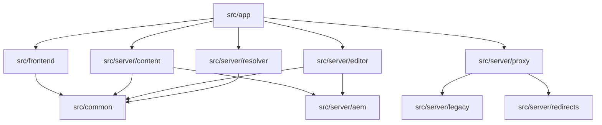

# Visão Geral da Arquitetura

## Camadas principais

1. `src/app`: rotas, layout, metadata e API routes
2. `src/server`: conteúdo, editor, proxy, legado, redirects e segurança
3. `src/frontend`: componentes CMS, PageShell, wrappers do DS e utilitários
4. `src/common`: contratos e registry gerado

### Regras de acesso entre camadas

| Camada                                         | Pode acessar                              | Não pode acessar                     |
| ---------------------------------------------- | ----------------------------------------- | ------------------------------------ |
| **Apresentação** (`src/frontend`)              | Props tipadas, hooks React, Design System | Adapter, AEM Client, Registry direto |
| **Orquestração** (`src/server/resolver`)       | Registry, Mappers, Loader                 | AEM Client, autenticação, proxy      |
| **Conteúdo** (`src/server/content`, `editor`)  | CMSAdapter, EditorPlugin, NormalizedPage  | Componentes React, Registry          |
| **Infraestrutura** (`src/server/proxy`, `aem`) | AEM Client, Auth, Cache, Middleware       | Componentes React, Resolver          |

## Contratos TypeScript centrais

A arquitetura é sustentada por 5 interfaces que funcionam como fronteiras de
comunicação entre camadas:

| Contrato                | O que é                                           | Arquivo                             |
| ----------------------- | ------------------------------------------------- | ----------------------------------- |
| `NormalizedPage`        | Página normalizada, independente de CMS           | `src/common/types/page.ts`          |
| `CMSAdapter`            | Interface de busca de conteúdo (4 métodos)        | `src/server/content/`               |
| `EditorPlugin`          | Interface de edição visual (separada do adapter)  | `src/server/editor/`                |
| `RegistryEntry`         | Entrada de componente: loader + mapper + metadata | `src/common/types/registry.ts`      |
| `QualifiedComponentKey` | Branded type `"group/name@version"`               | `src/common/types/registry-keys.ts` |
| `LayoutComponent`       | Componente React com `{ page, children }`         | `src/frontend/layouts/types.ts`     |

## Extensões de produção do portal

Além do núcleo de renderização, o portal adiciona:

- middleware com classificação de requests (9 etapas)
- suporte a conteúdo legado servido de `public/`
- processamento SSI
- redirect handler com GraphQL e cache em memória
- fallback de downloads no DAM
- PageShell com Design System, GTM, Header/Footer e Assistente

## Responsabilidades centrais

- `getPage()` devolve `NormalizedPage | null`
- `PageShell` injeta comportamento global de página
- `resolveComponent()` carrega componentes e mappers via registry
- `proxy.ts` decide quando a request segue para headless, legado, DAM ou
  redirect

## Regras arquiteturais

- `src/app` e `src/frontend` não devem importar `@/server/aem/*`
- o adapter é o único ponto autorizado para traduzir o shape bruto do provider
- `componentGroups` governa editor e runtime
- `public/` faz parte da estratégia oficial de entrega, não é apenas um
  depósito de assets

## Glossário

| Termo         | Definição                                                                           |
| ------------- | ----------------------------------------------------------------------------------- |
| **AEM**       | Adobe Experience Manager — CMS headless usado como fonte de conteúdo                |
| **UE**        | Universal Editor — editor visual inline da Adobe para edição ao vivo                |
| **Registry**  | Catálogo gerado `Map<QualifiedComponentKey, RegistryEntry>` com lookup O(1)         |
| **Resolver**  | Função que consulta o registry, carrega componente + mapper e renderiza via SSR     |
| **Adapter**   | Implementação de `CMSAdapter` que traduz payload bruto do CMS para `NormalizedPage` |
| **Layout**    | Componente de estrutura HTML que envolve as seções; selecionado por `pageLayout`    |
| **PageShell** | Shell de página que injeta Design System, GTM, Header/Footer e Assistente                  |
| **SSI**       | Server Side Includes — diretivas `<!--#include -->` em HTMLs legados                |
| **DS** | Design System do projeto — CSS/JS tokens e web components                    |
