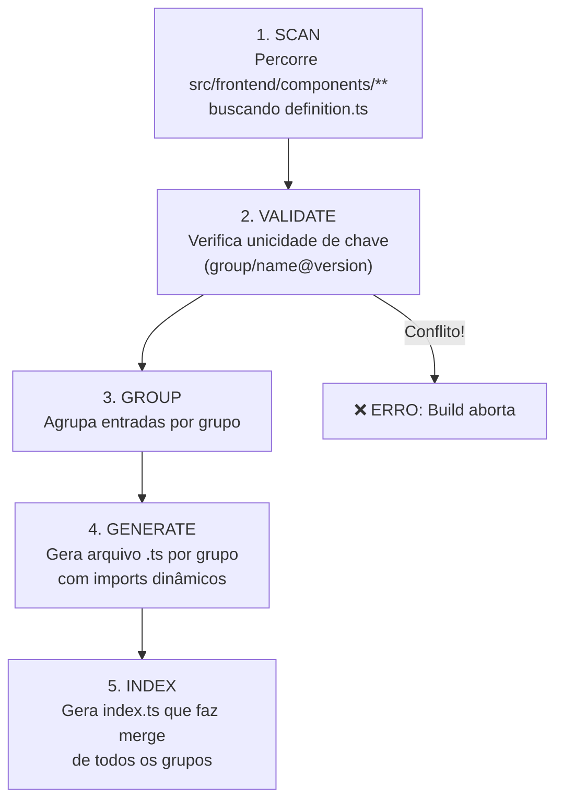
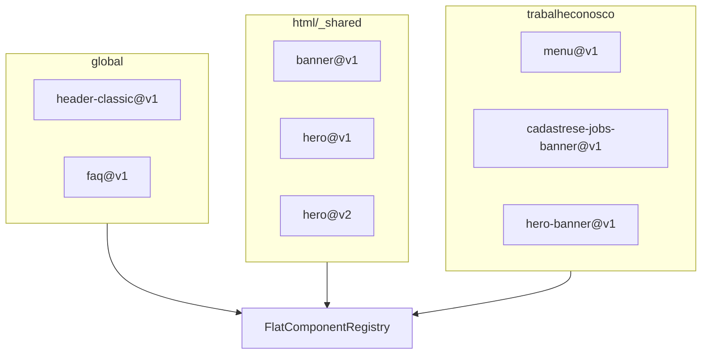

# Sistema de Registry

O registry é o catálogo central que conecta conteúdo do CMS a componentes
React. Ele é **gerado automaticamente** a partir dos `definition.ts`
espalhados pelo código — não é escrito manualmente.

## Origem e Estrutura no Filesystem

```
src/frontend/components/
├── global/
│   └── sections/FAQ/v1/
│       ├── definition.ts      ← Fonte de verdade
│       ├── mapper.ts
│       └── Component.tsx
├── html/common/sections/
│   ├── Banner/v1/
│   │   ├── definition.ts
│   │   └── ...
│   └── Hero/
│       ├── v1/definition.ts
│       └── v2/definition.ts
└── trabalheconosco/
    └── sections/Menu/v1/
        ├── definition.ts
        └── ...
```

## O que um `definition.ts` contém

```typescript
import { ComponentDefinition } from "@/common/types/aem";

export const definition: ComponentDefinition = {
  componentName: "banner",
  version: "v1",
  group: "html/_shared",
  title: "Banner",
  description: "Componente de banner com imagem, título e CTA",
  fields: [
    { name: "title", label: "Título", valueType: "string", component: "text" },
    {
      name: "description",
      label: "Descrição",
      valueType: "richtext",
      component: "richtext",
    },
    {
      name: "fileReference",
      label: "Imagem",
      valueType: "reference",
      component: "aem-content",
    },
  ],
};
```

### Interfaces principais

```typescript
interface ComponentDefinition {
  componentName: string; // Identificador técnico (ex: "banner", "faq")
  version: string; // Versão (ex: "v1", "v2")
  group: string; // Grupo de governança (ex: "html/_shared", "global")
  title: string; // Nome legível para o editor
  description?: string;
  fields: ComponentField[]; // Campos editáveis no Universal Editor
}

interface ComponentField {
  name: string; // Nome da propriedade no JCR
  label: string; // Label legível no editor
  valueType: string; // "string" | "richtext" | "boolean" | "number" | "reference"
  required?: boolean;
  multi?: boolean;
  component?: string; // Widget do editor (ex: "text", "richtext", "boolean-toggle")
}
```

O `group` é especialmente importante — determina em quais páginas o componente
pode ser inserido. O template AEM configura `componentGroups` por página e o
Universal Editor filtra os componentes disponíveis com base nisso.

## Geração Automática

O script `scripts/generate-component-registries.ts` roda em build time e
segue 5 passos:



Se duas definitions tiverem a mesma chave qualificada, o gerador **aborta com
erro** — chaves duplicadas são inaceitáveis.

### Arquivos gerados

| Arquivo                                            | Conteúdo                                   |
| -------------------------------------------------- | ------------------------------------------ |
| `src/common/generated/registry/global.ts`          | Componentes do grupo `global`              |
| `src/common/generated/registry/html-shared.ts`     | Componentes do grupo `html/_shared`        |
| `src/common/generated/registry/trabalheconosco.ts` | Componentes do grupo `trabalheconosco`     |
| `src/common/generated/registry/index.ts`           | Merge de todos num `FlatComponentRegistry` |

### Quando rodar o gerador

Rode `npm run generate:registries` sempre que criar, renomear, mudar o
`group`/`version` ou deletar um componente. Os hooks `predev` e `prebuild`
executam automaticamente.

## Tipos do Registry

### `FlatComponentRegistry` e `RegistryEntry`

```typescript
type FlatComponentRegistry = Map<QualifiedComponentKey, RegistryEntry>;

interface RegistryEntry {
  definition: ComponentDefinition;
  loader: () => Promise<{ default: React.ComponentType<any> }>; // Import dinâmico
  mapper: (data: Record<string, unknown>) => Record<string, unknown>;
}
```

### `QualifiedComponentKey` — Branded Type

A chave de lookup é um **branded type** que previne uso de strings genéricas:

```typescript
type QualifiedComponentKey = string & { __brand: "QualifiedComponentKey" };

// ❌ Não compila — string genérica:
const key: QualifiedComponentKey = "html/_shared/banner@v1";

// ✅ Compila — usa função construtora:
const key = createQualifiedKey("html/_shared", "banner", "v1");
// → "html/_shared/banner@v1" as QualifiedComponentKey
```

Funções utilitárias em `src/common/utils/registry-keys.ts`:

- `createQualifiedKey(group, name, version)` — cria uma chave qualificada
- `parseQualifiedKey(key)` — decompõe em `{ group, name, version }`
- `isValidQualifiedKey(str)` — valida formato

### Facade de acesso

O registry é acessado via facade (`src/common/sites/auto-registry.ts`), não
diretamente. Isso permite trocar a implementação no futuro.

## Grupos ativos do portal



## Papel de `componentGroups`

Mesmo com o componente presente no registry, ele só é elegível quando a página
autoriza seu grupo em `componentGroups`. Essa regra limita tanto o picker do
editor quanto a renderização em runtime.

## Capacidades adicionais do portal

O registry do portal também informa:

- `singleton` — componentes que aparecem no máximo uma vez por página
- `minDsVersion` — versão mínima do Design System necessária
- loaders de mapper — carregamento lazy do transformador de props

## Erros Comuns

### 1. Esquecer de rodar o gerador

```
[component-resolver] Component not found: html/_shared/novo-componente@v1
```

**Solução:** `npm run generate:registries`

### 2. Chave qualificada duplicada

O gerador aborta com erro mostrando os dois `definition.ts` conflitantes.
Altere o `componentName` ou `group` de um deles.

### 3. `group` inconsistente com a governança de página

Componente existe no registry mas não aparece no picker do UE. Verifique se
o `componentGroups` do template AEM inclui o grupo do componente.

### 4. Editar arquivos gerados manualmente

Mudanças em `src/common/generated/registry/` são sobrescritas pelo gerador.
Sempre modifique o `definition.ts` e rode o gerador.

### 5. Usar string literal como `QualifiedComponentKey`

Use `createQualifiedKey()` em vez de cast direto de string.

## Referência de Arquivos

| Conceito                                        | Arquivo                                      |
| ----------------------------------------------- | -------------------------------------------- |
| Tipo `QualifiedComponentKey`                    | `src/common/types/registry-keys.ts`          |
| Funções de chave                                | `src/common/utils/registry-keys.ts`          |
| Tipos `FlatComponentRegistry` + `RegistryEntry` | `src/common/types/registry.ts`               |
| Tipos `ComponentDefinition` + `ComponentField`  | `src/common/types/aem.ts`                    |
| Facade de acesso                                | `src/common/sites/auto-registry.ts`          |
| Registry gerado                                 | `src/common/generated/registry/index.ts`     |
| Script gerador                                  | `scripts/generate-component-registries.ts`   |
| Component Resolver                              | `src/server/resolver/component-resolver.tsx` |
