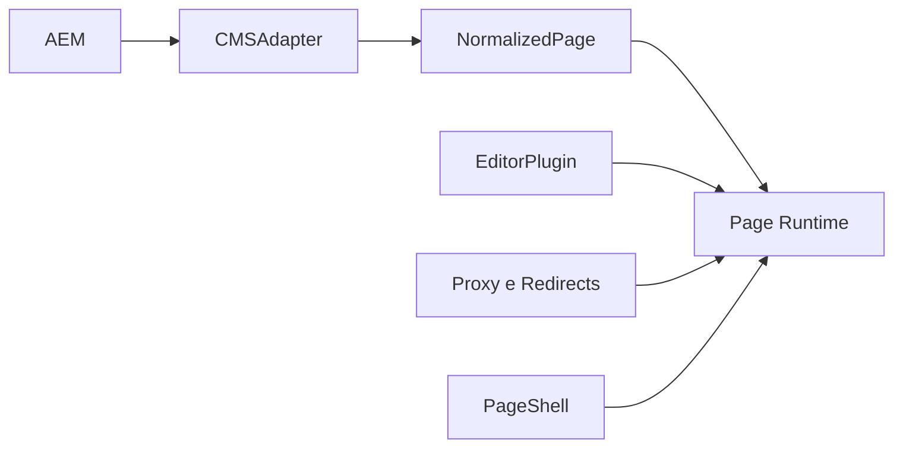

# Estratégia CMS

## Objetivo

O portal separa o consumo de conteúdo do runtime de página para limitar o
acoplamento do restante da aplicação ao provider.

## Fronteiras oficiais

- `CMSAdapter`: conteúdo, redirects, assets e auth
- `NormalizedPage`: contrato consumido pela renderização
- `EditorPlugin`: integração com o editor visual
- `getEditorProps()`: anotações de DOM

## O que é agnóstico

- `src/app/**`, exceto a lógica puramente operacional de legado
- `src/frontend/**`, exceto a shell específica do portal
- `src/server/content/**`
- `src/server/editor/**`
- `src/server/resolver/**`

## O que é específico do provider ou da operação

- `src/server/aem/**`
- `src/server/redirects/**`
- `src/server/legacy/**`
- `src/server/proxy.ts`
- `PageShell`, por depender da infraestrutura do portal

## Regra prática

Mudanças de shape bruto ou de editor devem parar no adapter ou no plugin.
Mudanças de entrega operacional do portal pertencem ao proxy, à camada legacy
ou ao PageShell.
