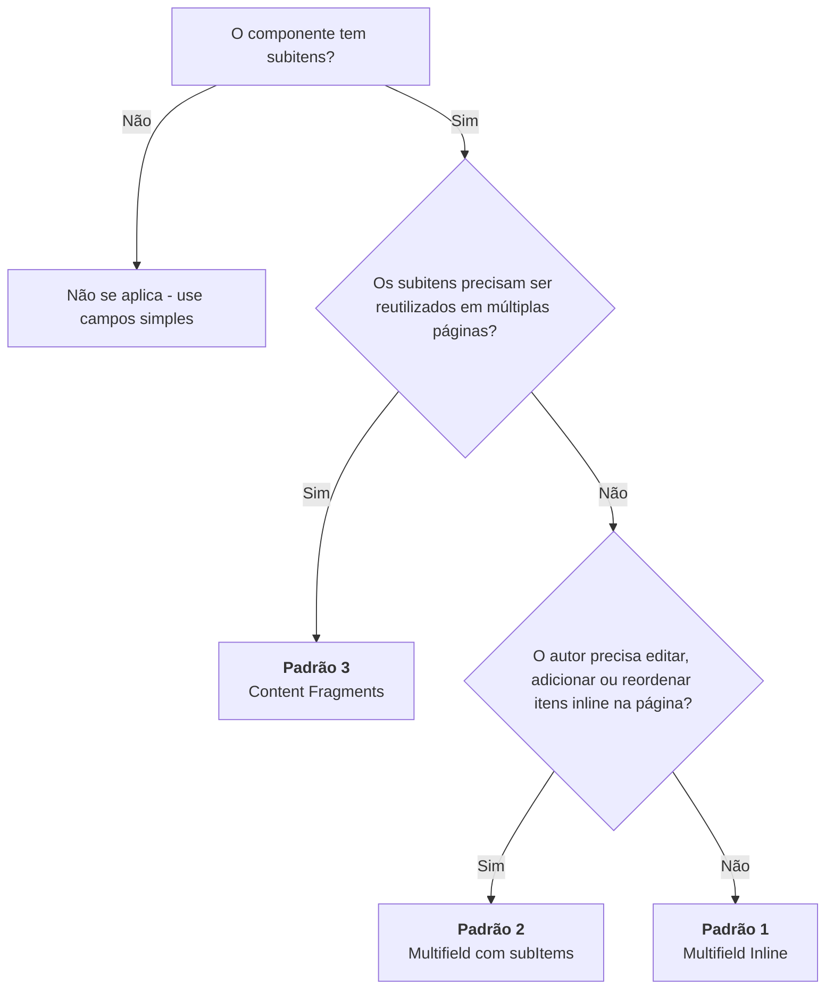

# Componentes com Subitens — Guia de Padrões

## Sumário

- [Introdução](#introdução)
- [Árvore de Decisão](#árvore-de-decisão)
- [Padrão 1: Multifield Inline](#padrão-1-multifield-inline)
- [Padrão 2: Multifield com subItems](#padrão-2-multifield-com-subitems)
- [Padrão 3: Content Fragments como Referências](#padrão-3-content-fragments-como-referências)
- [Tabela Comparativa](#tabela-comparativa)
- [Recomendação do Projeto](#recomendação-do-projeto)
- [Referências](#referências)

---

## Introdução

Muitos componentes do portal possuem **subitens**: listas de itens filhos que
compõem o conteúdo principal. Exemplos comuns:

- Itens de FAQ (pergunta + resposta)
- Slides de um carrossel/banner
- Itens de download
- Links de menu

Este documento define **3 padrões** para implementar subitens com
AEM + Universal Editor (UE), quando usar cada um e como implementá-los.

> **Pré-requisito:** familiaridade com o sistema de componentes
> (`definition.ts` / `mapper.ts` / `Component.tsx`). Veja
> [Criando Componentes](./creating-components.md) para os conceitos base.

---

## Árvore de Decisão

Use o fluxo abaixo para escolher o padrão correto:



**Regra geral:** comece pelo Padrão 2 (`subItems`) sempre que o item for
composto. O Padrão 1 é para item escalar; o Padrão 3, para reuso entre páginas.
Ver `reference/autoria/`.

---

## Padrão 1: Multifield Inline

### Quando usar

- Subitens com poucos campos (2-4 campos por item)
- Edição via painel lateral do UE é suficiente
- Não há necessidade de editar itens inline na página
- Não há necessidade de reuso cross-page

### Exemplo real: FAQ do Portal

#### `definition.ts`

Os campos do subitem ficam dentro do array `fields` do campo `multifield`.
Não há array `subItems` na definição.

```ts
// seu-projeto/src/frontend/components/global/sections/FAQ/v1/definition.ts

import type { ComponentDefinition } from "@/common/types/aem";

const definition: ComponentDefinition = {
  modelId: "global--faq",
  name: "faq",
  version: "v1",
  title: "FAQ -- Perguntas Frequentes",
  group: "global",
  icon: "help",
  minDsVersion: "1.33.6",
  fields: [
    { name: "title", label: "Título da seção", type: "text" },
    {
      name: "items",
      label: "Itens do FAQ",
      type: "multifield",
      fields: [
        { name: "question", label: "Pergunta", type: "text" },
        { name: "answer", label: "Resposta", type: "richtext" },
        { name: "footer", label: "Rodapé (opcional)", type: "richtext" },
      ],
    },
  ],
};

export default definition;
```

#### `mapper.ts`

O mapper normaliza os dados do AEM, que podem vir como array ou como objeto
JCR, para um array tipado. Não rastreia `_path` por item.

```ts
// seu-projeto/src/frontend/components/global/sections/FAQ/v1/mapper.ts

import type { MapperFn } from "@/common/types/registry";

export interface FAQItem {
  _key: string;
  question: string;
  answer: string;
  footer?: string;
}

function normalizeItems(raw: unknown): FAQItem[] {
  if (!raw) return [];

  if (Array.isArray(raw)) {
    return raw.filter(Boolean).map((item, index) => {
      let obj: Record<string, unknown>;
      if (typeof item === "string") {
        try {
          obj = JSON.parse(item) as Record<string, unknown>;
        } catch {
          obj = {};
        }
      } else if (item && typeof item === "object") {
        obj = item as Record<string, unknown>;
      } else {
        obj = {};
      }

      return {
        _key: `item${index}`,
        question: (obj.question as string) ?? "",
        answer: (obj.answer as string) ?? "",
        footer: (obj.footer as string) || undefined,
      };
    });
  }

  if (typeof raw === "object") {
    return (
      Object.entries(raw as Record<string, unknown>).filter(
        ([, v]) => !!v && typeof v === "object",
      ) as [string, Record<string, unknown>][]
    ).map(([, item], index) => ({
      _key: `item${index}`,
      question: (item.question as string) ?? "",
      answer: (item.answer as string) ?? "",
      footer: (item.footer as string) || undefined,
    }));
  }

  return [];
}

const mapFAQ: MapperFn = (data) => ({
  title: (data.title as string | undefined) ?? "Perguntas frequentes",
  items: normalizeItems(data.items),
  _path: data._path,
});

export default mapFAQ;
```

#### `Component.tsx`

Os subitens **não** recebem `data-aue-resource` individual. A edição
acontece via painel lateral do UE no campo multifield.

```tsx
// Exemplo didático simplificado, baseado no padrão usado no portal

export default function FAQ({ title, items = [], _path }: FAQProps) {
  return (
    <section
      data-aue-resource={`urn:aemconnection:${_path}`}
      data-aue-type="component"
      data-aue-model="global--faq"
      data-aue-label="FAQ"
    >
      <h2 data-aue-prop="title" data-aue-type="text">
        {title}
      </h2>

      <div>
        {items.map((item) => (
          <details key={item._key}>
            <summary>{item.question}</summary>
            <div dangerouslySetInnerHTML={{ __html: item.answer }} />
          </details>
        ))}
      </div>
    </section>
  );
}
```

### Estrutura de dados

```text
Seção FAQ (nó JCR)
  ├── title: "Perguntas frequentes"
  └── items[] --> array de objetos no mesmo nó
        ├── { question: "...", answer: "..." }
        └── { question: "...", answer: "..." }
```

### Prós e contras

| Prós                                | Contras                                  |
| ----------------------------------- | ---------------------------------------- |
| Simples de implementar              | Edição apenas no painel lateral          |
| Menos arquivos e infraestrutura     | Sem drag-and-drop visual de itens        |
| Mapper direto, sem `_path` por item | Sem edição inline de cada item           |
| Ideal para listas simples           | Painel pode ficar ruim com muitos campos |

---

## Padrão 2: Multifield com subItems

### Quando usar

- Subitens com muitos campos (5+ campos por item)
- O autor precisa editar itens inline na página
- Há necessidade frequente de reordenar itens visualmente
- Há necessidade de adicionar/remover itens no canvas do UE
- Não há necessidade de reuso cross-page

### Diferenças-chave em relação ao Padrão 1

| Aspecto                                | Padrão 1 | Padrão 2 |
| -------------------------------------- | -------- | -------- |
| `subItems` no `definition.ts`          | Não      | Sim      |
| `model` no campo multifield            | Não      | Sim      |
| `_path` por item no mapper             | Não      | Sim      |
| `data-aue-resource` por item           | Não      | Sim      |
| `data-aue-type="container"` no wrapper | Não      | Sim      |
| `data-aue-filter` no wrapper           | Não      | Sim      |

### Exemplo real: FAQ do Boilerplate

> A infraestrutura compartilhada já prevê esse padrão, mas os componentes
> atuais do `seu-projeto` ainda seguem majoritariamente o Padrão 1.

#### `definition.ts`

O campo multifield referencia o model do subitem via `model`, e a definição
expõe um array `subItems`.

```ts
// nextjs-aem-ue-boilerplate/src/frontend/components/sections/Faq/v1/definition.ts

import type { ComponentDefinition } from "@/common/types/aem";

export const MODEL_ID = "sections--faq";
export const FAQ_ITEM_MODEL_ID = "sections--faq-item";

const definition: ComponentDefinition = {
  modelId: MODEL_ID,
  name: "faq",
  version: "v1",
  title: "FAQ",
  group: "sections",
  icon: "help",
  fields: [
    { name: "title", label: "Título da Seção", type: "text" },
    {
      name: "items",
      label: "Perguntas",
      type: "multifield",
      model: FAQ_ITEM_MODEL_ID,
      fields: [
        { name: "question", label: "Pergunta", type: "text" },
        { name: "answer", label: "Resposta", type: "richtext" },
      ],
    },
  ],
  subItems: [
    {
      id: FAQ_ITEM_MODEL_ID,
      title: "Item de FAQ",
      containerField: "items",
      fields: [
        { name: "question", label: "Pergunta", type: "text" },
        { name: "answer", label: "Resposta", type: "richtext" },
      ],
    },
  ],
};

export default definition;
```

> **Importante:** hoje os campos do `multifield.fields` e do
> `subItems[].fields` ficam duplicados. Isso exige disciplina para manter
> ambos sincronizados.

#### `mapper.ts`

O mapper calcula `_path` por item para instrumentação do UE.

```ts
// nextjs-aem-ue-boilerplate/src/frontend/components/sections/Faq/v1/mapper.ts

import type { MapperFn } from "@/common/types/registry";

export interface FaqItemMapped {
  _key: string;
  _path: string;
  question: string;
  answer: string;
}

function normalizeItems(raw: unknown, parentPath?: string): FaqItemMapped[] {
  if (!raw) return [];

  const itemsBasePath = parentPath ? `${parentPath}/items` : "";

  if (Array.isArray(raw)) {
    return raw.filter(Boolean).map((item, index) => {
      const obj =
        item && typeof item === "object"
          ? (item as Record<string, unknown>)
          : {};
      const key = `item${index}`;

      return {
        _key: key,
        _path: itemsBasePath ? `${itemsBasePath}/${key}` : "",
        question: (obj.question as string) ?? "",
        answer: (obj.answer as string) ?? "",
      };
    });
  }

  if (typeof raw === "object") {
    return (
      Object.entries(raw as Record<string, unknown>).filter(
        ([, v]) => !!v && typeof v === "object",
      ) as [string, Record<string, unknown>][]
    ).map(([key, item]) => ({
      _key: key,
      _path: itemsBasePath ? `${itemsBasePath}/${key}` : "",
      question: (item.question as string) ?? "",
      answer: (item.answer as string) ?? "",
    }));
  }

  return [];
}

const mapFaq: MapperFn = (data) => ({
  title: (data.title as string | undefined) ?? "",
  items: normalizeItems(data.items, data._path as string | undefined),
  _path: data._path,
});

export default mapFaq;
```

#### `Component.tsx`

Cada item recebe `data-aue-resource`, `data-aue-type="component"` e
`data-aue-model`. O wrapper vira um `container` com `filter`.

```tsx
// Exemplo didático simplificado, baseado no boilerplate

import { FAQ_ITEM_MODEL_ID, MODEL_ID } from "./definition";

export default function Faq({ title, items = [], _path }: FaqProps) {
  return (
    <section
      data-aue-resource={_path ? `urn:aemconnection:${_path}` : undefined}
      data-aue-type="component"
      data-aue-model={MODEL_ID}
      data-aue-label="FAQ"
    >
      <h2 data-aue-prop="title" data-aue-type="text">
        {title}
      </h2>

      <div
        data-aue-resource={
          _path ? `urn:aemconnection:${_path}/items` : undefined
        }
        data-aue-type="container"
        data-aue-label="Perguntas"
        data-aue-filter={FAQ_ITEM_MODEL_ID}
      >
        {items.map((item) => (
          <details
            key={item._key}
            data-aue-resource={
              item._path ? `urn:aemconnection:${item._path}` : undefined
            }
            data-aue-type="component"
            data-aue-model={FAQ_ITEM_MODEL_ID}
            data-aue-label="Item de FAQ"
          >
            <summary data-aue-prop="question" data-aue-type="text">
              {item.question}
            </summary>
            <div
              data-aue-prop="answer"
              data-aue-type="richtext"
              dangerouslySetInnerHTML={{ __html: item.answer }}
            />
          </details>
        ))}
      </div>
    </section>
  );
}
```

### Estrutura de dados

```text
Seção FAQ (nó JCR)
  ├── title: "FAQ"
  └── items/ --> sub-nós JCR
        ├── item0/
        │     ├── question: "Pergunta 1"
        │     └── answer: "<p>Resposta 1</p>"
        └── item1/
              ├── question: "Pergunta 2"
              └── answer: "<p>Resposta 2</p>"
```

### O que acontece por baixo

O sistema de geração automática em
`seu-projeto/src/server/aem/component-definitions.ts` usa
`subItems` para gerar automaticamente:

1. Model UE do subitem
2. Entry do subitem no component picker
3. Filter UE do container

### Prós e contras

| Prós                                   | Contras                            |
| -------------------------------------- | ---------------------------------- |
| Edição inline de cada item             | Campos duplicados na definição     |
| Drag-and-drop para reordenar           | Mapper mais complexo               |
| Add/remove visual na página            | Mais atributos `data-aue-*` no JSX |
| Geração automática de models e filters | Maior risco de dessincronização    |
| Boa UX para itens ricos                | Mais trabalho de implementação     |

---

## Padrão 3: Content Fragments como Referências

### Quando usar

- Subitens que precisam ser reutilizados em múltiplas páginas
- Dados do subitem são gerenciados de forma independente
- É importante editar o item uma vez e refletir em vários contextos
- Existe necessidade real de compartilhar conteúdo, e não apenas hipótese

> **Diretriz do projeto:** usar Content Fragments apenas quando houver real
> necessidade de reuso e governança centralizada. Não adotar esse padrão por
> padrão, já que ele traz mais custo de modelagem, integração e manutenção.

### Exemplo real: Downloads do 2B Capital

No 2B Capital, cada `DownloadItem` é um Content Fragment independente no
AEM DAM. A `DownloadsSection` referencia esses CFs via campo de referências.

#### Tipos TypeScript

```ts
// 2b-capital-nextjs/src/types/aem-types.ts

export interface DownloadItem {
  _path: string;
  title: string;
  icon: ContentReference;
  iconalt: string;
  pdffile: ContentReference;
  linktitle?: string;
  trackinglabel?: string;
}

export interface DownloadsSection {
  __typename: "TwobcapitalDownloadsSectionModel";
  _path: string;
  title: string;
  sectionid?: string;
  downloads: DownloadItem[];
  sideimage?: ContentReference;
  sideimagealt?: string;
}
```

#### Componente pai: `DownloadsSection.tsx`

O wrapper dos subitens usa `data-aue-type="container"` com filter. A
seção em si é `data-aue-type="reference"`.

```tsx
// 2b-capital-nextjs/src/components/sections/DownloadsSection.tsx

export function DownloadsSectionComponent({ data }: Props) {
  return (
    <div
      data-aue-type="reference"
      data-aue-resource={`urn:aemconnection:${data._path}/jcr:content/data/master`}
      data-aue-label="Downloads Section"
    >
      <h3 data-aue-prop="title" data-aue-type="text">
        {data.title}
      </h3>

      <div
        data-aue-type="container"
        data-aue-resource={`urn:aemconnection:${data._path}/jcr:content/data/master`}
        data-aue-prop="downloads"
        data-aue-label="Downloads"
        data-aue-filter="download-items"
      >
        {data.downloads?.map((download) => (
          <DownloadItemComponent key={download._path} data={download} />
        ))}
      </div>
    </div>
  );
}
```

#### Componente filho: `DownloadItem.tsx`

Cada item é um `reference` com seu próprio `data-aue-resource` apontando
para o CF individual.

```tsx
// 2b-capital-nextjs/src/components/sections/DownloadItem.tsx

export function DownloadItemComponent({ data }: Props) {
  return (
    <div
      data-aue-type="reference"
      data-aue-resource={`urn:aemconnection:${data._path}/jcr:content/data/master`}
      data-aue-label={data.title}
    >
      <a href={pdfUrl} target="_blank" rel="noopener noreferrer">
        
        <p data-aue-prop="title" data-aue-type="text">
          {data.title}
        </p>
      </a>
    </div>
  );
}
```

#### Configuração UE

Diferente dos Padrões 1 e 2, aqui os JSONs do UE são escritos manualmente.

**`component-definition.json`**

```json
{
  "groups": [
    {
      "title": "Items",
      "id": "items",
      "components": [
        {
          "title": "Download Item",
          "id": "download-item",
          "plugins": {
            "aem": {
              "cf": {
                "cfModel": "/conf/.../twobcapital-download-item",
                "cfFolder": "/content/dam/.../downloads"
              }
            }
          }
        }
      ]
    }
  ]
}
```

**`filter-definition.json`**

```json
[
  {
    "id": "download-items",
    "components": ["download-item"]
  }
]
```

### Estrutura de dados

```text
AEM DAM
  └── /content/dam/.../
        ├── sections/
        │     └── downloads-section-1 (CF)
        │           └── downloads[] --> referências para CFs filhos
        └── downloads/
              ├── download-item-1 (CF)
              ├── download-item-2 (CF)
              └── download-item-3 (CF)
```

### Requisitos no AEM

Para usar este padrão, é necessário configurar no AEM:

1. CF Model para o item
2. CF Model para a seção pai
3. CF Folder para armazenar os itens
4. GraphQL para resolver referências
5. JSONs de configuração UE

### Prós e contras

| Prós                                       | Contras                                         |
| ------------------------------------------ | ----------------------------------------------- |
| Reuso cross-page de subitens               | Mais infraestrutura no AEM                      |
| Edição centralizada                        | Configuração manual maior                       |
| Edição inline completa                     | Mais complexidade de modelagem                  |
| Cada item é independente                   | Maior custo de manutenção                       |
| Boa governança para conteúdo compartilhado | Não usa o fluxo automatizado de `definition.ts` |

---

## Tabela Comparativa

| Aspecto                      | Padrão 1        | Padrão 2                       | Padrão 3               |
| ---------------------------- | --------------- | ------------------------------ | ---------------------- |
| Complexidade                 | Baixa           | Média                          | Alta                   |
| Edição inline                | Não             | Sim                            | Sim                    |
| Drag-and-drop                | Não             | Sim                            | Sim                    |
| Add/remove visual            | Não             | Sim                            | Sim                    |
| Reuso cross-page             | Não             | Não                            | Sim                    |
| Geração automática           | Sim             | Sim                            | Não                    |
| `_path` por item             | Não             | Sim                            | Sim                    |
| `data-aue-resource` por item | Não             | Sim                            | Sim                    |
| Armazenamento                | Array no nó JCR | Sub-nós JCR                    | CFs no DAM             |
| Infraestrutura extra no AEM  | Não             | Não                            | Sim                    |
| Melhor uso                   | Listas simples  | Itens ricos e editáveis inline | Conteúdo compartilhado |

---

## Recomendação do Projeto

Esta é a recomendação prática para o monorepo:

1. **Padrão 2 (`subItems`) por default** sempre que o item tiver 2+ campos,
   imagem ou link
2. **Padrão 1** só quando o item for um valor escalar único (string, tag)
3. **Padrão 3 somente quando houver reuso real entre páginas**

> **Revisado.** A recomendação anterior era "Padrão 1 por default, evolua para
> o 2 quando precisar". Isso está superado: a Adobe documenta que `condition`
> não é suportado dentro de multi container e que multifield aninhado é
> proibido, então o Padrão 1 com item composto não tem saída — vira dialog
> gigante. Ver `reference/autoria/` para a decisão completa e as fontes.

Em outras palavras: **nem tudo deve virar Content Fragment**. O custo extra só
se paga quando existe uma necessidade concreta de compartilhamento,
centralização e governança do conteúdo.

---

## Referências

- Padrão 1: `seu-projeto/src/frontend/components/global/sections/FAQ/v1/`
- Padrão 2: `nextjs-aem-ue-boilerplate/src/frontend/components/sections/Faq/v1/`
- Padrão 3: `2b-capital-nextjs/src/components/sections/DownloadsSection.tsx`
