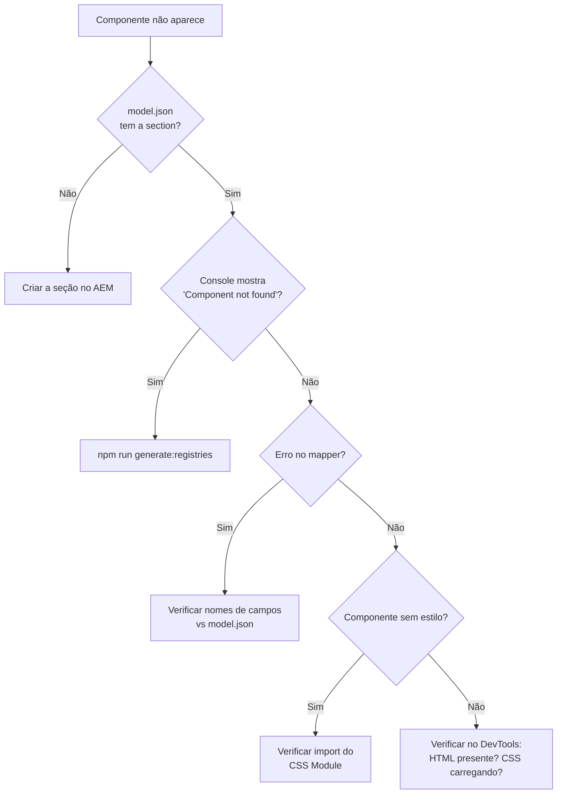

# Criando Componentes

## Escolha do grupo

Use esta regra prática:

- `global`: componentes estruturais ou reaproveitados amplamente
- `html/_shared`: componentes compartilhados entre páginas HTML do portal
- `trabalheconosco`: componentes exclusivos da jornada de carreira

## Estrutura esperada

```text
src/frontend/components/<grupo-físico>/sections/<NomeComponente>/<versão>/
  definition.ts
  mapper.ts
  Component.tsx
  Component.module.css
```

## Exemplo completo: Card

### Passo 1 — `definition.ts`

```typescript
import { ComponentDefinition } from "@/common/types/aem";

export const definition: ComponentDefinition = {
  componentName: "card",
  version: "v1",
  group: "html/_shared",
  title: "Card",
  description: "Card com imagem, título e descrição",
  fields: [
    {
      name: "title",
      label: "Título",
      valueType: "string",
      component: "text",
      required: true,
    },
    {
      name: "description",
      label: "Descrição",
      valueType: "richtext",
      component: "richtext",
    },
    {
      name: "fileReference",
      label: "Imagem",
      valueType: "reference",
      component: "aem-content",
    },
    {
      name: "ctaLabel",
      label: "Texto do botão",
      valueType: "string",
      component: "text",
    },
    {
      name: "ctaLink",
      label: "Link do botão",
      valueType: "string",
      component: "text",
    },
  ],
};
```

- `componentName` deve ser único dentro do mesmo `group` + `version`
- `fields` define os campos editáveis no Universal Editor
- `group` determina a governança — a página precisa do grupo em `componentGroups`

### Passo 2 — `mapper.ts`

```typescript
export interface CardProps {
  title: string;
  description: string;
  imageSrc: string;
  ctaText: string;
  ctaUrl: string;
}

export function mapCardProps(data: Record<string, unknown>): CardProps {
  return {
    title: (data.title as string) ?? "",
    description: (data.description as string) ?? "",
    imageSrc: (data.fileReference as string) ?? "",
    ctaText: (data.ctaLabel as string) ?? "",
    ctaUrl: (data.ctaLink as string) ?? "",
  };
}
```

O mapper tem 3 responsabilidades:

1. **Normalização** — fallbacks com `?? ""` para campos ausentes
2. **Renomeação** — campos AEM (`ctaLabel`) para nomes React (`ctaText`)
3. **Transformação** — conversão de tipos quando necessário

### Passo 3 — `Component.tsx`

```tsx
import styles from "./Component.module.css";
import { CardProps } from "./mapper";

export default function Card({
  title,
  description,
  imageSrc,
  ctaText,
  ctaUrl,
}: CardProps) {
  return (
    <article className={styles.card}>
      {imageSrc && }
      <div className={styles.content}>
        <h3 className={styles.title}>{title}</h3>
        {description && (
          <div
            className={styles.description}
            dangerouslySetInnerHTML={{ __html: description }}
          />
        )}
        {ctaText && ctaUrl && (
          <a className={styles.cta} href={ctaUrl}>
            {ctaText}
          </a>
        )}
      </div>
    </article>
  );
}
```

- O `export default` é **obrigatório** — o registry usa import dinâmico
- Use CSS Modules (`.module.css`) — é o padrão do projeto
- O componente **não sabe nada sobre AEM** — recebe apenas props tipadas

### Passo 4 — `Component.module.css`

```css
.card {
  border-radius: 8px;
  overflow: hidden;
  box-shadow: 0 2px 8px rgba(0, 0, 0, 0.1);
}
.image {
  width: 100%;
  height: auto;
}
.content {
  padding: 16px;
}
.title {
  margin: 0 0 8px;
}
.description {
  margin: 0 0 16px;
}
.cta {
  display: inline-block;
  padding: 8px 16px;
  background: var(--color-primary, #0055ff);
  color: white;
  text-decoration: none;
  border-radius: 4px;
}
```

### Passo 5 — Regenerar o registry

```bash
npm run generate:registries
```

Após rodar, o componente estará disponível com a chave `html/_shared/card@v1`.

## Checklist de novo componente

- [ ] `definition.ts` com `componentName`, `version`, `group`, `fields`
- [ ] `mapper.ts` com interface de props + função de mapeamento
- [ ] `Component.tsx` com `export default`
- [ ] `Component.module.css` com estilos
- [ ] Registry regenerado (`npm run generate:registries`)
- [ ] `npm run lint` passa sem erros

## Multifield — Tratamento de listas

O AEM pode retornar listas como array ou sub-nós JCR. Use o padrão defensivo
no mapper:

```typescript
function normalizeMultifield(raw: unknown): Record<string, unknown>[] {
  if (Array.isArray(raw)) return raw;
  if (typeof raw === "object" && raw !== null) return Object.values(raw);
  return [];
}

// Uso:
const items = normalizeMultifield(data.items).map((item) => ({
  title: (item.title as string) ?? "",
}));
```

Para padrões avançados de subitens, veja
[Componentes com Subitens](./component-subitens.md).

## Debugging — Quando o componente não aparece



## Design System

Se o componente depende do Design System:

- documente a necessidade no `definition.ts`
- use `minDsVersion` quando houver requisito mínimo
- lembre que `tokens-only` não entrega web components

## Editor

Use `getEditorProps()` para as anotações de edição. O componente não deve
montar `data-aue-*` manualmente.

---

## Criando uma nova versão de componente

Quando um componente precisa evoluir com quebra de compatibilidade (nova
estrutura de props, campos renomeados, comportamento diferente), crie uma
**nova versão** em vez de alterar a existente.

### Por que versionar em vez de alterar

- páginas no AEM que usam `v1` continuam funcionando sem mudança de template
- times paralelos podem migrar para `v2` no próprio ritmo
- o registry mantém ambas as versões disponíveis simultaneamente

### Estrutura

```text
src/frontend/components/<grupo>/sections/<NomeComponente>/
  v1/
    definition.ts
    mapper.ts
    Component.tsx
  v2/                        ← nova pasta, não modifica v1
    definition.ts
    mapper.ts
    Component.tsx
```

### Passo a passo

**1. Crie a pasta `v2/`** com os 3 arquivos principais.

**2. No `definition.ts` da v2**, incremente apenas a versão:

```typescript
export const definition: ComponentDefinition = {
  componentName: "card", // mesmo nome
  version: "v2", // versão incrementada
  group: "html/_shared", // mesmo grupo
  // ... campos novos
};
```

**3. No `mapper.ts` da v2**, implemente o novo mapeamento independente da v1:

```typescript
export default function mapCardV2Props(data: Record<string, unknown>) {
  return {
    // novo contrato de props
  };
}
```

**4. Regenere o registry:**

```bash
npm run generate:registries
```

Após rodar, ambas as chaves `html/_shared/card@v1` e `html/_shared/card@v2`
estarão disponíveis.

**5. No AEM**, atualize as páginas que devem usar a nova versão para `version: "v2"`.
Páginas não atualizadas continuam usando `v1` automaticamente.

### Checklist de nova versão

- [ ] pasta `v2/` criada sem modificar `v1/`
- [ ] `version: "v2"` no `definition.ts` da nova pasta
- [ ] `mapper.ts` independente (não importa da v1)
- [ ] `Component.tsx` com `export default`
- [ ] Registry regenerado
- [ ] `npm run lint` passa

### Quando desativar uma versão antiga

Só remova `v1` quando **todas** as páginas AEM que a referenciam tiverem sido
migradas para `v2`. Remover antes quebra silenciosamente páginas em produção —
a seção some sem erro visível.
