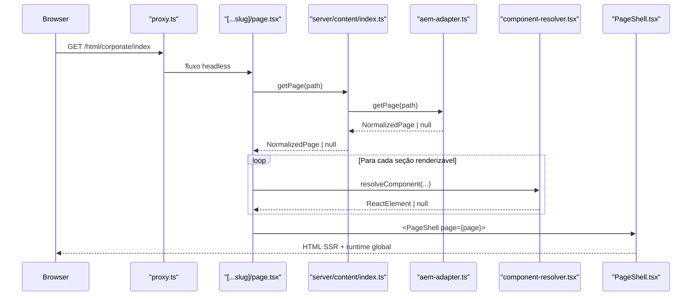
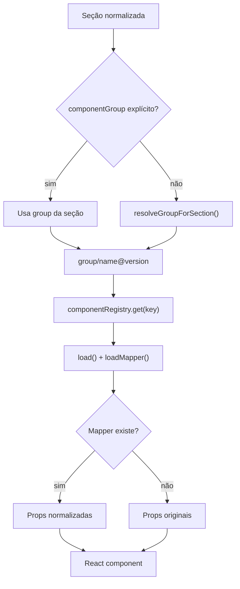
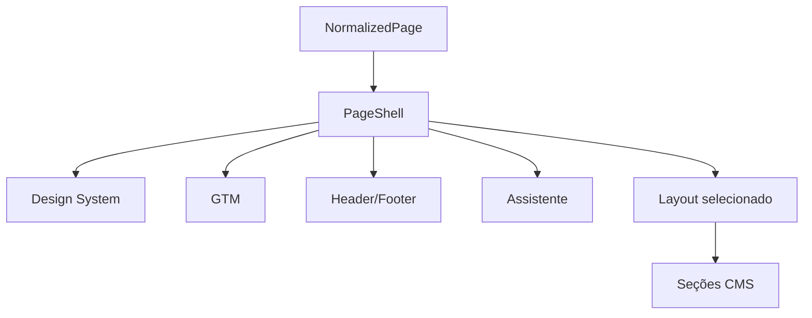
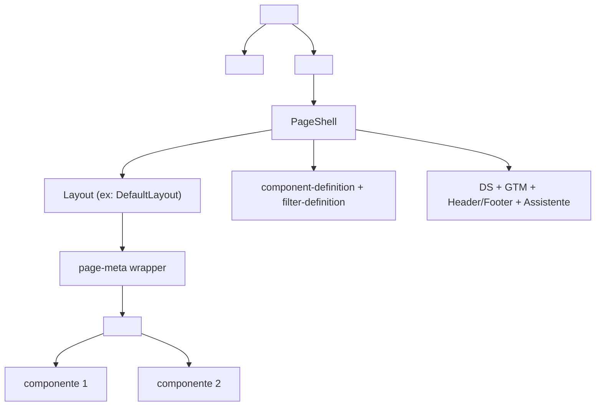

# Renderização de Página

Este documento descreve o fluxo completo de renderização de uma página do
portal, incluindo a resolução headless, o papel do `PageShell` e os pontos de
decisão que afetam o HTML final.

## Visão Geral

No portal, a renderização de página acontece depois que a request já passou
pela classificação do middleware. A partir daí, o fluxo segue esta ordem:

1. `src/app/[...slug]/page.tsx` reconstrói o path
2. o runtime verifica sinais do middleware, como `x-middleware-not-found`
3. `getPage()` busca a página pelo adapter
4. a página filtra componentes singleton
5. cada seção resolve grupo, versão e componente
6. `PageShell` injeta runtime global de página
7. a rota injeta payloads do editor quando o editor está ativo



## Etapa 1: Sinalização do Middleware

Antes de qualquer fetch de conteúdo, `page.tsx` consulta `headers()` para
verificar se o middleware marcou a request com `x-middleware-not-found`.

Isso permite interromper imediatamente o fluxo headless em casos como:

- path malformado
- normalização bloqueada pela camada de borda

Se esse header existir, a rota chama `notFound()` sem consultar o CMS.

## Etapa 2: Resolução do Path

`buildContentPath(slug)` junta os segmentos da URL em um path de conteúdo.

Exemplos:

| URL                      | Path reconstruído       |
| ------------------------ | ----------------------- |
| `/html/corporate/index`  | `html/corporate/index`  |
| `/html/pf/produtos`      | `html/pf/produtos`      |
| `/trabalheconosco/vagas` | `trabalheconosco/vagas` |

## Etapa 3: Busca da Página e Metadata

`getPage(path)` usa `React.cache()` para que:

- `generateMetadata()`
- o componente da página

reaproveitem a mesma busca dentro do request.

O resultado é sempre `NormalizedPage | null`.

`generateMetadata()` monta:

- `title`
- `description`
- `keywords`
- `canonical`
- Open Graph
- favicon

usando fallbacks do contrato de página e `buildAssetUrl()` para assets.

## Etapa 4: Filtragem de Singleton

Antes do loop principal de renderização, o portal consulta:

- `getSingletonTypes()`

Isso gera o conjunto de tipos marcados como `singleton` no registry.

Se a página repetir uma seção singleton:

- apenas a primeira ocorrência é renderizada
- as demais são descartadas antes do resolver

Essa regra é importante para componentes estruturais do portal.

## Etapa 5: Resolução do Grupo e do Componente

Cada seção tenta descobrir seu grupo final a partir de:

- `section.data.componentGroup`, quando a seção força explicitamente um grupo
- `resolveGroupForSection(type, version, componentGroups)` caso contrário

A chave final usada no registry é:

```text
group/name@version
```



## Etapa 6: Contexto de Design System

O portal passa contexto extra ao resolver:

- `dsVersion`
- `useDesignSystem`
- `dsMode`

Esses valores vêm de `NormalizedPage` e permitem que o resolver emita warnings
quando:

- um componente exige DS, mas a página está em `none`
- a página está em `tokens-only`, mas o componente precisa de JS
- a `dsVersion` da página é menor que a exigida por `minDsVersion`

## Etapa 7: Layout de Página

Depois de resolver as seções, `page.tsx` seleciona o layout a partir do campo
`pageLayout` da página:

```typescript
const Layout = layouts[page.pageLayout ?? "default"] ?? layouts["default"];
```

O registry de layouts fica em `src/frontend/layouts/index.ts`. Cada layouté um Server Component com a interface `LayoutProps`:

```typescript
interface LayoutProps {
  page: NormalizedPage;
  children: React.ReactNode; // seções já resolvidas
}
```

O **`DefaultLayout`** — usado para todos os valores não registrados — monta:

- `<div>` com atributos do editor visual (page-meta wrapper)
- `<main>` com `className`, `data-layout`, `data-segment` e atributos de container

Para criar um novo layout, veja [Criando Layouts](../development/creating-layouts.md).

## Etapa 8: Envoltório com `PageShell`

Depois de resolver as seções, a página envolve o conteúdo em
`<PageShell page={page}>`.

**Arquivo:** `src/frontend/components/global/components/PageShell.tsx`

`PageShell` injeta:

- CSS e JS do Design System
- GTM
- Header/Footer v2
- Assistente



### Campos de runtime em `NormalizedPage`

O portal usa campos de página que impactam diretamente a renderização pelo
`PageShell`, pelo layout e pelo resolver:

| Campo             | Afeta                                       |
| ----------------- | ------------------------------------------- |
| `segment`         | classe CSS no `<main>` e `data-segment`     |
| `pageLayout`      | qual layout estrutural é usado              |
| `dsVersion`       | versão do Design System carregada           |
| `dsMode`          | modo do DS: `none`, `tokens-only` ou `full` |
| `useDesignSystem` | flag que ativa/desativa o DS                |
| `hfType`          | tipo do Header/Footer                       |
| `hfShow`          | visibilidade do Header/Footer               |
| `hfProduct`       | produto associado ao Header/Footer          |
| `gtmContainerId`  | container GTM da página                     |
| `showAssistant`         | exibição do Assistente (assistente flutuante)      |

## Etapa 9: Editor e Estrutura HTML Final

Se `editorPlugin.isEnabled()` retornar `true`, `page.tsx` injeta **antes** do
layout:

- `component-definition` inline
- `filter-definition` inline

O `DefaultLayout` (e qualquer layout customizado que siga a convenção) anota:

- o wrapper externo como `page-meta` (via `getEditorProps`)
- o `<main>` como container da página

O `<main>` final recebe:

- `className` baseado em `segment`
- `data-layout`
- `data-segment`



## Pontos de Decisão Importantes

### 1. Página inexistente

Se `getPage(path)` devolver `null`, a rota chama `notFound()`.

### 2. Grupo não encontrado

Se a seção não puder ser associada a nenhum grupo válido:

- a seção é descartada
- um warning é emitido em desenvolvimento

### 3. Componente ausente

Se a chave `group/name@version` não existir no registry:

- o resolver registra warning
- a seção vira `null`
- a página continua renderizando

### 4. Falha em componente isolado

`ComponentErrorBoundary` protege o restante da página contra falhas de um único
componente.

### 5. Incompatibilidade de DS

Warnings de DS não derrubam a renderização, mas ajudam a detectar páginas mal
configuradas no conteúdo.

## Onde Depurar Quando Algo Quebra

| Sintoma                    | Primeiro lugar para olhar                           |
| -------------------------- | --------------------------------------------------- |
| 404 inesperado             | middleware, `x-middleware-not-found` e `getPage()`  |
| seções não renderizam      | `componentGroups`, singleton e resolver             |
| shell incompleto           | `PageShell` e campos de página                      |
| editor sem picker correto  | `editorPlugin`, payloads inline e `componentGroups` |
| componente com DS quebrado | `dsMode`, `dsVersion` e `minDsVersion`              |

## Relação com Outros Documentos

- [Visão geral da arquitetura](../architecture/overview.md)
- [Sistema de registry](../architecture/registry-system.md)
